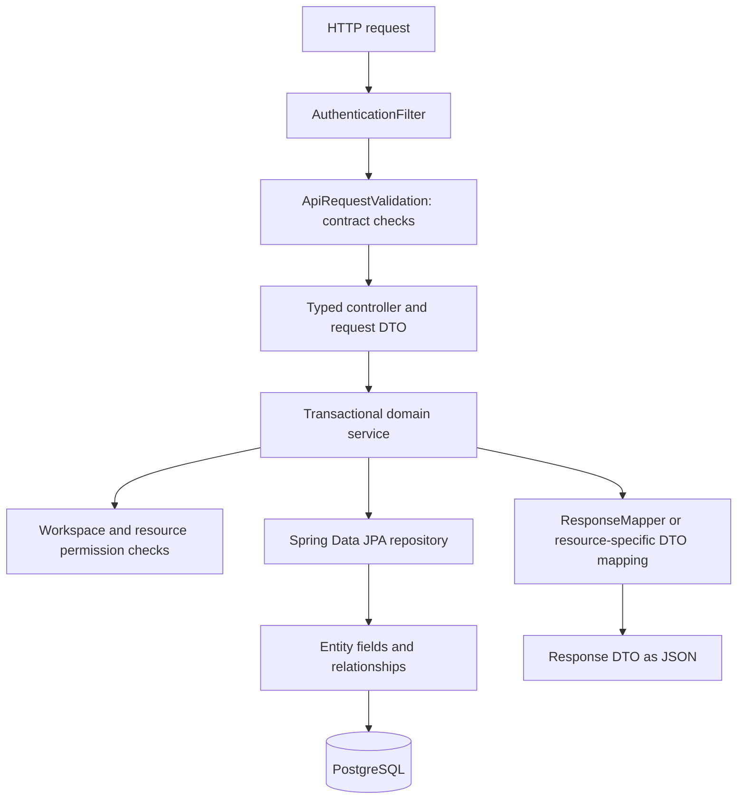

# Shinchoku backend: entities, repositories, services and DTOs

The backend now uses Spring Data JPA and Hibernate. Every one of the 25 database tables has an entity class, and ordinary persistence goes through typed repositories. Controllers and services use typed request/response DTOs instead of database-row maps.

## Follow one request



Authentication and contract validation happen before the controller. Permission checks can happen several times while a service validates related resources. The service owns the transaction; the entity is never returned directly as an API response.

## Where to start reading

1. `src/main/java/com/shinchoku/shinchokuapp/entity/Issue.java` — the issue's database fields, typed state/priority, relationships and `@Version`.
2. `src/main/java/com/shinchoku/shinchokuapp/repository/IssueRepository.java` — typed persistence, inherited CRUD and Criteria support.
3. `src/main/java/com/shinchoku/shinchokuapp/dto/IssueCreateRequest.java` and `IssueResponse.java` — what the API accepts and returns.
4. `src/main/java/com/shinchoku/shinchokuapp/api/IssueController.java` — HTTP parameters are bound to those Java types.
5. `src/main/java/com/shinchoku/shinchokuapp/service/IssueService.java` — start at `createIssue`, then read `updateIssue`.
6. `src/main/java/com/shinchoku/shinchokuapp/security/Access.java` — authorization remains separate from entity mapping and foreign keys.
7. `src/test/java/com/shinchoku/shinchokuapp/JpaPersistenceTests.java` — runnable entity, relationship and PostgreSQL array/JSONB examples.

## The responsibilities

| Package | Purpose | Example |
| --- | --- | --- |
| `entity` | Maps tables/columns to persistent Java objects | `Issue`, `User`, `Team`, `WorkspaceMember` |
| `entity/id` | Represents composite primary keys | `WorkspaceMemberId`, `IssueLabelId` |
| `entity/enums` | Gives states/roles/priorities named Java values | `IssueState.IN_PROGRESS`, `WorkspaceRole.OWNER` |
| `entity/converter` | Keeps the database's existing lowercase text values | `IssueStateConverter` |
| `repository` | Reads/writes entities through Spring Data JPA | `IssueRepository`, `UserRepository` |
| `dto` | Defines HTTP payloads without persistence internals | `IssueCreateRequest`, `IssueResponse`, `PageResponse<T>` |
| `service` | Applies business rules inside transactions | `IssueService`, `WorkspaceService` |
| `api` | Binds HTTP requests and validates their contract | `IssueController`, `ApiRequestValidation` |
| `persistence` | Reusable typed Criteria/pagination support | `JpaPredicates`, `JpaPagination` |

## What an entity does

```java
@Entity
@Table(name = "issues")
public class Issue extends UuidEntity {
    @Column(name = "title", nullable = false)
    private String title;

    @Version
    private int version = 1;
}
```

`@Entity` tells Hibernate that this is a persistent model. `@Table` chooses its existing table. `@Column` maps a Java field to its column. `UuidEntity` supplies the generated UUID primary key.

The actual class also contains the workspace/team IDs, typed fields, timestamps, getters/setters and lazy relationships. Changing `issue.setTitle(...)` inside a service transaction changes a managed entity. Hibernate writes that change when it flushes; `saveAndFlush` makes the write immediate when the service needs to detect a database conflict before continuing.

Foreign-key ID fields are explicit and writable. Navigation associations such as `issue.getTeam()` are read-only mappings over those same columns, with no cascade writes. This keeps the existing composite tenant constraints authoritative and makes resource-ID checks visible in service code. Services validate all referenced resources before setting their IDs.

## Entity versus DTO

An entity describes persistence. A DTO describes the public API.

- `Issue` includes persistence identity, version and associations.
- `IssueCreateRequest` describes allowed input; the client cannot supply the creator ID or issue number.
- `IssueResponse` contains the approved output fields and computed identifier/labels/GitHub metadata.

For sensitive entities such as `ApiKey` and `UserSession`, their response DTOs intentionally have no token-hash field. Entities are not serialized directly. This also prevents lazy proxies and ORM relationships from unexpectedly becoming part of an API response.

## Creating an issue

`IssueService.createIssue` checks writable team access and referenced resources, constructs an `Issue`, sets its typed fields and saves it through `IssueRepository`. Label join entities and an `IssueActivity` event are saved in the same transaction.

The display number has one deliberate native-SQL repository helper: `IssueNumberAllocator.reserve`. Its PostgreSQL `UPDATE ... RETURNING` atomically increments the team counter. It returns a typed `long`; it does not return a generic row map. The rest of the workflow uses entities and repositories.

The UUID remains the database identity. A display identifier such as `ENG-482` combines the team key and reserved number.

## Editing an issue and concurrent requests

The client supplies `expectedVersion`. `IssueService.updateIssue` first compares it with `issue.getVersion()`. Hibernate's `@Version` then protects the actual SQL update too: two requests that both read version 1 cannot both successfully update it.

The winning update increments the version. A losing update returns HTTP 409 and rolls back. Labels and activity events are only written after the versioned entity flush succeeds. Even a label-only edit updates the issue timestamp so the version changes.

Workspace-owner changes, cycle overlap checks and triage decisions use pessimistic repository locks where a version check alone would not protect a multi-row business rule.

## Omitted and null PATCH fields

PATCH request DTOs are classes with typed fields and setters that track whether each field was supplied.

```java
if (request.hasAssigneeId()) {
    issue.setAssigneeId(request.getAssigneeId());
}
```

Omitting `assigneeId` keeps the current value. Explicitly supplying `"assigneeId": null` clears it. Supplying an empty `labelIds` list clears the labels; an omitted list keeps them. The presence checks are typed methods such as `hasAssigneeId()` rather than string-key access to an untyped request map.

## PostgreSQL features and schema ownership

- Composite keys use `@EmbeddedId` classes with equality/hash-code implementations.
- Text arrays are mapped as `String[]` using Hibernate's array type.
- JSONB activity changes use a map because that field is deliberately an open-ended JSON document, not an untyped replacement for the entity.
- Enum converters preserve existing lowercase text values, such as `in_progress`.
- Flyway still owns table creation, indexes, check constraints and composite foreign keys.
- `spring.jpa.hibernate.ddl-auto=validate` checks mappings without generating or changing tables.
- `spring.jpa.open-in-view=false` keeps ORM work inside the service transaction.

The OpenAPI validator also uses maps to inspect JSON-schema metadata and raw input at the HTTP boundary. Those maps are not used as domain entities, repository results, or ordinary service request/response models. A JDBC map helper remains only under `src/test` for regression-test fixture setup and is not packaged with production code.

## Verify the project

With Docker Desktop running, execute this in the backend folder:

```powershell
.\mvnw.cmd verify
```

Tests use disposable PostgreSQL containers. They verify existing API behavior plus entity mappings, relationships, version changes, JSONB/arrays, nullable PATCH fields and competing edits.
