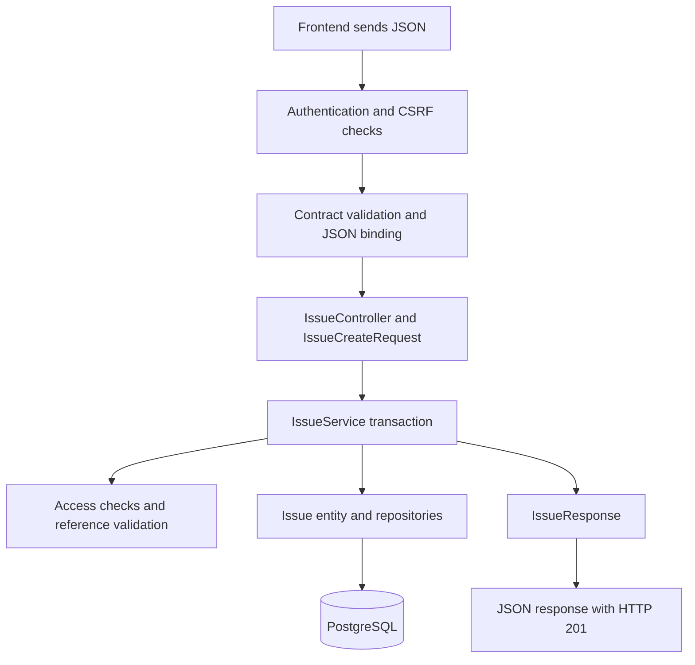

# Learning the Shinchoku backend, class by class

This tutorial describes the code in `C:/Users/thana/Desktop/Shinchoku-Services` as reviewed on November 11, 2026. It covers every named Java type in the application and tests: 179 production types and six test types, across 180 Java source files. “Type” includes classes, records, interfaces, enums, and an annotation. A few files contain more than one named type.

Read the first lesson in order. Use the class catalog as a reference afterward. You do not need to memorize 185 names: most repeat a small set of patterns. The explanations describe this project's choices; they are not requirements that every Spring project must copy.

Contents:

1. [First lesson: follow an issue from JSON to the database](#first-lesson-follow-an-issue-from-json-to-the-database)
2. [Entities: the persistent objects](#entities-the-persistent-objects)
3. [Composite IDs](#composite-ids)
4. [Enums and converters](#enums-and-converters)
5. [Repositories](#repositories)
6. [DTOs: inputs and outputs](#dtos-inputs-and-outputs)
7. [Controllers and HTTP support](#controllers-and-http-support)
8. [Services and business rules](#services-and-business-rules)
9. [Authentication and permission classes](#authentication-and-permission-classes)
10. [Query and pagination helpers](#query-and-pagination-helpers)
11. [Tests](#tests)
12. [Configuration, exercises, and a reading schedule](#configuration-exercises-and-a-reading-schedule)

## First lesson: follow an issue from JSON to the database

### The five main responsibilities

| Kind of code | Question it answers | Example in your project |
| --- | --- | --- |
| Request DTO | What information may the frontend send? | `IssueCreateRequest` |
| Controller | Which HTTP request calls which method? | `IssueController` |
| Service | What must happen, and what rules must hold? | `IssueService` |
| Entity | How is a stored item represented in Java? | `Issue` |
| Repository | How do we load and persist that entity? | `IssueRepository` |
| Response DTO | Which information do we send back? | `IssueResponse` |

An entity is the closest equivalent to the database-item class you learned previously. A DTO can look similar because the API and database discuss the same issue, but their responsibilities differ. For example, the client supplies a title; the backend supplies the creator, generated UUID, display number, timestamps, and version.



The diagram groups several framework stages for readability. Security filters run before Spring MVC; the MVC interceptor checks operation metadata, body advice validates JSON, and Jackson binds the validated JSON to the DTO before the controller method runs.

### 1. Starting the application

`ShinchokuappApplication.main` calls `SpringApplication.run(...)`. Spring discovers components under `com.shinchoku.shinchokuapp`, creates services/controllers, creates repository implementations, and supplies their dependencies. Boot configures the web server and persistence from the dependencies and properties.

For example, `IssueController` declares:

```java
private final IssueService issueService;

public IssueController(IssueService issueService) {
    this.issueService = issueService;
}
```

This is constructor injection. The controller needs a service, so Spring passes one in. `final` means the controller does not replace that reference after construction. It does not make all service data immutable. You do not create a new service for each request or call a repository constructor yourself.

### 2. The entity: `Issue`

The essential shape, with most fields and methods omitted, is:

```java
@Entity
@Table(name = "issues")
public class Issue extends UuidEntity {
    @Column(name = "title", nullable = false, columnDefinition = "text")
    private String title;

    @Column(name = "state", nullable = false, columnDefinition = "text")
    private IssueState state = IssueState.TODO;

    @Version
    @Column(name = "version", nullable = false)
    private int version = 1;
}
```

`@Entity` registers a persistent Java type. `@Table` names its database table. `@Column` maps a field to a column. `extends UuidEntity` inherits the UUID primary-key mapping. `IssueState.TODO` is a Java default used for a newly constructed issue. `@Version` protects updates from competing editors.

One `Issue` object represents one issue row. The class describes every row's shape; `new Issue()` constructs one particular object. It does not immediately insert a row. Hibernate must persist it inside a transaction.

`@Column(nullable = false)` describes persistence/schema expectations. It is not a complete frontend-input validator. This project also uses the OpenAPI contract, Bean Validation where annotated, service checks, and real database constraints.

### 3. Identity and relationships

`UuidEntity.id` is generated with `GenerationType.UUID`. It is the persistent identity. `Issue.number`, together with `Team.key`, produces a human-readable identifier such as `ENG-42`. Those are separate purposes.

An issue contains an explicit writable `teamId` plus a navigation association:

```java
@ManyToOne(fetch = FetchType.LAZY)
@JoinColumn(name = "team_id", insertable = false, updatable = false)
private Team team;
```

Many issues can refer to one team. `LAZY` defers loading the related object until needed. Here, `teamId` writes the foreign-key column; `team` provides object navigation over the same column. `insertable = false, updatable = false` prevents two writable mappings for one column. It does not make the team itself globally read-only. This is a deliberate design in this project, not the only valid way to map JPA relationships.

Services validate that referenced IDs belong to the correct workspace/team. A Java relationship and a valid UUID do not grant permission. If a scalar foreign-key ID changes after an association has already been loaded, do not assume the in-memory association automatically changes to match; reload/refresh as appropriate. Existing composite database foreign keys remain the final ownership checks.

### 4. The input: `IssueCreateRequest`

```java
public record IssueCreateRequest(
    @NotNull UUID teamId,
    @NotNull String title,
    String description,
    IssueState state,
    IssuePriority priority,
    UUID assigneeId,
    UUID projectId,
    UUID cycleId,
    LocalDate dueOn,
    List<UUID> labelIds) {}
```

A Java `record` is a concise data carrier. Java supplies its constructor, accessors such as `request.title()`, and equality/hash-code/toString methods. Record components cannot be reassigned after construction; a list stored in a record is not automatically deeply immutable.

Jackson converts the HTTP JSON into this record. `@NotNull` is a Bean Validation annotation, triggered through the controller's `@Valid`. The contract validator enforces additional rules before binding. Notice that the request has no `creatorId` or issue number: the server chooses those.

A small valid-looking example, assuming the team exists and the caller has permission, is:

```json
{
  "teamId": "11111111-1111-4111-8111-111111111111",
  "title": "Add a dark theme",
  "priority": "high"
}
```

The UUID is illustrative. It is not a team automatically seeded in your database.

### 5. The HTTP entry: `IssueController.createIssue`

```java
@ContractOperation("createIssue")
@PostMapping("/workspaces/{workspaceId}/issues")
public ResponseEntity<IssueResponse> createIssue(
    @PathVariable("workspaceId") UUID workspaceId,
    @Valid @RequestBody IssueCreateRequest requestBody) {
    return ResponseEntity.status(201)
        .body(issueService.createIssue(workspaceId, requestBody));
}
```

The class has `@RequestMapping("/api/v1")`, so the complete route is `POST /api/v1/workspaces/{workspaceId}/issues`. `@PathVariable` reads the UUID from the URL. `@RequestBody` reads the JSON body. `@Valid` requests Bean Validation. `@ContractOperation` is our custom link to the supplied OpenAPI rules; it is not a built-in Spring annotation. `ResponseEntity` contains the HTTP status and body, and 201 means a resource was created.

The controller delegates work. It does not decide whether the assignee is a workspace member or whether the project belongs to the same team. Those rules belong to the service and `Access`.

### 6. The workflow: `IssueService.createIssue`

Read this method in seven groups:

1. **Check access.** `requireTeamAccess(workspaceId, request.teamId(), true)` requires write permission. The boolean `true` means a write is required.
2. **Check references.** `validateReferences(...)` validates the assignee, project, cycle, and labels, including their workspace/team ownership.
3. **Construct the entity.** `new Issue()` creates a transient Java object. Setters fill its fields, retaining Java defaults when optional inputs are omitted.
4. **Choose server-owned values.** The allocator reserves the team's issue number. `Caller.current().userId()` supplies the creator from authentication. A new issue created in `DONE` gets a completion timestamp.
5. **Persist and flush.** `issueRepository.saveAndFlush(issue)` persists the issue and sends pending SQL to the database, allowing database conflicts to surface before continuing.
6. **Persist related rows.** `replaceLabels(...)` writes `IssueLabel` join entities. `recordActivity(...)` writes an `IssueActivity` event.
7. **Build output.** `toResponse(issue)` adds approved fields, labels, the computed identifier, and optional GitHub metadata to an `IssueResponse`.

`IssueService` has `@Service` and `@Transactional`. A call through Spring's service proxy runs in a transaction. The issue, labels, and activity can commit together. A failure that rolls the transaction back also rolls back SQL already flushed within that transaction. **Flush does not mean commit.** The transactional proxy completes the transaction before returning the result to the controller. The default rollback behavior includes the unchecked `ApiException` used here.

The entity returned by a repository can be *managed*: Hibernate tracks its changes inside the persistence context. A managed entity changed inside a transaction can be updated at flush/commit without another explicit `save` call. You can see this in session revocation. Setting a field on an arbitrary detached or never-persisted object has no such effect.

### 7. The repository: why an empty interface works

```java
public interface IssueRepository
        extends WorkspaceScopedRepository<Issue> {}
```

`WorkspaceScopedRepository<T>` extends `JpaRepository<T, UUID>` and `JpaSpecificationExecutor<T>`. With `T = Issue`, Spring supplies methods to save, load, delete, count, and query issues. An empty body does not mean “no implementation”: Spring creates the implementation at startup.

The shared interface declares `findByWorkspaceIdAndId(...)`. Spring derives a query matching both Java properties. That scope matters: a UUID from another workspace should not be accepted simply because it exists. However, the inherited repository also exposes methods such as `findById`; the interface does not automatically add tenant filtering to every query. Services must choose scoped queries and enforce access.

`Optional<Issue>` means a query might return no issue. The common pattern `.orElseThrow(ApiException::missing)` turns that absence into the application's 404 error. `ApiException::missing` is a method reference, equivalent here to `() -> ApiException.missing()`.

### 8. The output: `IssueResponse`

The response record includes fields stored on `Issue` and API-specific additions such as `identifier`, `labels`, and `github`. Jackson turns this record into JSON after the controller returns it. The entity itself is not the response.

Most simple mappings are in `ResponseMapper`; the richer issue mapping is `IssueService.toResponse`. This is why editing an entity alone does not automatically add a field to the public API. Input/output shapes are deliberate.

### 9. Editing: omitted versus explicitly null

These two PATCH bodies express different actions:

```json
{"expectedVersion": 1, "title": "New title"}
```

```json
{"expectedVersion": 1, "assigneeId": null}
```

The first keeps the current assignee. The second clears it. A nullable Java field alone cannot tell those cases apart, so `IssuePatchRequest` extends `PatchRequest`. Each JSON setter records that its field was supplied. `hasAssigneeId()` is true even if `getAssigneeId()` returns null.

```java
if (request.hasAssigneeId()) {
    issue.setAssigneeId(request.getAssigneeId());
}
```

Only nullable fields may be explicitly null. Contract validation still rejects invalid nulls. For label lists, an omitted list preserves existing labels, while `[]` clears them.

### 10. Editing: two users at once

`expectedVersion` is the version the client last saw. `IssueService.updateIssue` compares it with the loaded entity before changing fields. Hibernate then checks `@Version` during the actual update. Conceptually, an update includes a condition such as `WHERE id = ? AND version = ?` and increments the version. This second check handles the race where two requests both initially read version 1.

One succeeds; the conflicting update returns 409 and rolls back. Issue updates flush before adding label/audit changes. Even a label-only edit changes `updatedAt` so the version advances.

The explicit version check helps give an early error; it does not replace Hibernate's concurrency check. Other multi-row rules, such as keeping a workspace owner or avoiding overlapping cycles, use pessimistic locks instead.

### A small Java-reading vocabulary

| Syntax | Meaning in this code |
| --- | --- |
| `this.title = title` | Assign the method argument to the current object's field. |
| `UUID` | A 128-bit identifier, not a display label or permission. |
| `LocalDate` | A calendar date, such as a due date. |
| `Instant` | A point on the UTC timeline, such as creation time. |
| `List<UUID>` | A list whose elements are UUIDs. |
| `PageResponse<IssueResponse>` | A page containing issue response objects. |
| `Integer` / `Boolean` | Object wrappers that can also be null. |
| `int` / `boolean` | Primitive values that cannot be null. |
| `var` | The compiler infers a local variable's type; the value is still statically typed. |
| `x -> ...` | A lambda: a small function passed to another operation. |
| `ResponseMapper::label` | A method reference passed as a function. |
| `.stream().map(...).toList()` | Transform a collection into another list. |
| `Specification<Issue>` | A reusable description of issue query conditions, not a result list. |
| `private` / `public` / `protected` | Controls which code can access a member. |
| `static` | Belongs to the type itself; no instance is needed to call it. |
| `@...` | Metadata interpreted by a framework; an annotation is not a method call. |

### `ShinchokuappApplication`

[Open ShinchokuappApplication](C:/Users/thana/Desktop/Shinchoku-Services/src/main/java/com/shinchoku/shinchokuapp/ShinchokuappApplication.java:6)

The application entry point. Its `main` method starts Spring Boot. `@SpringBootApplication` enables component scanning, configuration, and auto-configuration. This class starts the system; it does not handle issue business rules.

## Entities: the persistent objects

Except for the shared base, each entity below corresponds to a table. Plain getters read a field; plain setters assign it. They do not independently send SQL. The transaction/persistence context determines when changes are written. These models keep most business behavior in services.

For UUID-based entities, `id` is inherited and therefore is not repeated in the field lists below. Navigation object fields refer to related entities; explicit UUID fields own the corresponding column writes in this project.

### `UuidEntity`

[Open UuidEntity](C:/Users/thana/Desktop/Shinchoku-Services/src/main/java/com/shinchoku/shinchokuapp/entity/UuidEntity.java:7)

A shared `@MappedSuperclass`, not a table of its own. It gives subclasses a UUID primary key through `@Id` and `@GeneratedValue(strategy = GenerationType.UUID)`. Its ID is separate from business display identifiers such as `ENG-42`.

Fields/components in this type: `UUID id`.

### `User`

[Open User](C:/Users/thana/Desktop/Shinchoku-Services/src/main/java/com/shinchoku/shinchokuapp/entity/User.java:10)

Database mapping: `@Table(name = "users")`.

One person/account, independent of any particular workspace. The same user can join several workspaces through `WorkspaceMember`. Preferences such as timezone and theme belong here. There is no local password field; external identity associations are in `OAuthConnection`.

Fields/components in this type: `String email`, `String displayName`, `String avatarUrl`, `String timezone`, `Theme theme`, `Instant createdAt`.

### `Workspace`

[Open Workspace](C:/Users/thana/Desktop/Shinchoku-Services/src/main/java/com/shinchoku/shinchokuapp/entity/Workspace.java:10)

Database mapping: `@Table(name = "workspaces")`.

The top-level container for a group of teams and work. `name` is the displayed name; `slug` is a readable identifier. Creating one also creates an owner membership and default security policy in `WorkspaceService`.

Fields/components in this type: `String name`, `String slug`, `Instant createdAt`.

### `WorkspaceMember`

[Open WorkspaceMember](C:/Users/thana/Desktop/Shinchoku-Services/src/main/java/com/shinchoku/shinchokuapp/entity/WorkspaceMember.java:13)

Database mapping: `@Table(name = "workspace_members")`.

One user’s membership in one workspace. Its composite ID is `(workspaceId, userId)`, and its role is a `WorkspaceRole`. `removedAt` represents soft removal so historical foreign-key references remain valid. A non-null removal timestamp means the membership is no longer active.

Fields/components in this type: `WorkspaceMemberId id`, `WorkspaceRole role`, `Instant joinedAt`, `Instant removedAt`.

### `Team`

[Open Team](C:/Users/thana/Desktop/Shinchoku-Services/src/main/java/com/shinchoku/shinchokuapp/entity/Team.java:11)

Database mapping: `@Table(name = "teams")`.

A team inside one workspace. `key` is the prefix in issue identifiers. `nextIssueNumber` is a counter used by the atomic issue-number allocator. `archivedAt` marks an archived team; services reject work requiring a writable archived team.

Fields/components in this type: `UUID workspaceId`, `String name`, `String key`, `String description`, `Long nextIssueNumber`, `Instant archivedAt`, `Workspace workspace`.

### `TeamMember`

[Open TeamMember](C:/Users/thana/Desktop/Shinchoku-Services/src/main/java/com/shinchoku/shinchokuapp/entity/TeamMember.java:12)

Database mapping: `@Table(name = "team_members")`.

One user’s membership and role within one team. The composite ID contains workspace, team, and user. This is separate from workspace membership: being a workspace member and being a writable team member are different checks. `removedAt` allows soft removal.

Fields/components in this type: `TeamMemberId id`, `TeamRole role`, `Instant removedAt`.

### `Project`

[Open Project](C:/Users/thana/Desktop/Shinchoku-Services/src/main/java/com/shinchoku/shinchokuapp/entity/Project.java:11)

Database mapping: `@Table(name = "projects")`.

A body of work owned by a team. Contains description, planning dates/notes, state, optional lead, and archive timestamp. The service validates that a lead is an active workspace member and that target date does not precede planned start.

Fields/components in this type: `UUID workspaceId`, `UUID teamId`, `String name`, `String description`, `ProjectState state`, `UUID leadId`, `LocalDate plannedStart`, `LocalDate targetDate`, `String planningNotes`, `Instant archivedAt`, `Instant createdAt`, `Instant updatedAt`, `Workspace workspace`, `Team team`.

### `Milestone`

[Open Milestone](C:/Users/thana/Desktop/Shinchoku-Services/src/main/java/com/shinchoku/shinchokuapp/entity/Milestone.java:11)

Database mapping: `@Table(name = "milestones")`.

A named target within a project. It stores workspace/team/project ownership and an optional target date. Project permission is checked before milestone operations; the owning IDs are taken from the authorized project.

Fields/components in this type: `UUID workspaceId`, `UUID teamId`, `UUID projectId`, `String name`, `LocalDate targetDate`, `Workspace workspace`, `Team team`, `Project project`.

### `Cycle`

[Open Cycle](C:/Users/thana/Desktop/Shinchoku-Services/src/main/java/com/shinchoku/shinchokuapp/entity/Cycle.java:11)

Database mapping: `@Table(name = "cycles")`.

A numbered team planning window with `startsOn` and `endsOn`. Its stored data does not include status or progress: those are calculated for `CycleResponse`. Services enforce inclusive 14-day windows and prevent overlap within the same team.

Fields/components in this type: `UUID workspaceId`, `UUID teamId`, `Integer number`, `LocalDate startsOn`, `LocalDate endsOn`, `Workspace workspace`, `Team team`.

### `Label`

[Open Label](C:/Users/thana/Desktop/Shinchoku-Services/src/main/java/com/shinchoku/shinchokuapp/entity/Label.java:11)

Database mapping: `@Table(name = "labels")`.

A named workspace-wide label. Many issues may share a label, and an issue may have many labels. That relationship is stored explicitly in `IssueLabel`, rather than as a comma-separated field on `Issue`.

Fields/components in this type: `UUID workspaceId`, `String name`, `Workspace workspace`.

### `Issue`

[Open Issue](C:/Users/thana/Desktop/Shinchoku-Services/src/main/java/com/shinchoku/shinchokuapp/entity/Issue.java:11)

Database mapping: `@Table(name = "issues")`.

The main work item. Stores its ownership, display number, text, state/priority, references, dates, timestamps, and optimistic version. `@Version` detects competing edits. The title/assignment update workflow belongs to `IssueService`; getters/setters here describe data access.

Fields/components in this type: `UUID workspaceId`, `UUID teamId`, `Long number`, `String title`, `String description`, `IssueState state`, `IssuePriority priority`, `UUID assigneeId`, `UUID creatorId`, `UUID projectId`, `UUID cycleId`, `LocalDate dueOn`, `Instant completedAt`, `Instant archivedAt`, `int version`, `Instant createdAt`, `Instant updatedAt`, `Workspace workspace`, `Team team`, `User assignee`, `User creator`, `Project project`, `Cycle cycle`.

### `IssueLabel`

[Open IssueLabel](C:/Users/thana/Desktop/Shinchoku-Services/src/main/java/com/shinchoku/shinchokuapp/entity/IssueLabel.java:12)

Database mapping: `@Table(name = "issue_labels")`.

A join entity connecting one issue to one label within a workspace. Its composite ID is `(workspaceId, issueId, labelId)`; there is no separate generated ID or descriptive data. Explicit join entities make replacement and tenant scoping visible in service code.

Fields/components in this type: `IssueLabelId id`.

### `IssueComment`

[Open IssueComment](C:/Users/thana/Desktop/Shinchoku-Services/src/main/java/com/shinchoku/shinchokuapp/entity/IssueComment.java:11)

Database mapping: `@Table(name = "comments")`.

A comment on an issue, with author and creation/edit timestamps. `deletedAt` represents soft deletion; list queries exclude deleted comments. The service restricts editing to the author or a workspace administrator after checking writable issue access.

Fields/components in this type: `UUID workspaceId`, `UUID issueId`, `UUID authorId`, `String body`, `Instant createdAt`, `Instant updatedAt`, `Instant deletedAt`, `Workspace workspace`, `Issue issue`, `User author`.

### `IssueActivity`

[Open IssueActivity](C:/Users/thana/Desktop/Shinchoku-Services/src/main/java/com/shinchoku/shinchokuapp/entity/IssueActivity.java:15)

Database mapping: `@Table(name = "issue_activity")`.

An audit event about an issue. Records the authenticated actor, event kind, occurrence time, and JSONB `changes`. The map is appropriate for this deliberately variable JSON document; it is not a replacement for the typed entity. Charts replay relevant state events from this history.

Fields/components in this type: `UUID workspaceId`, `UUID issueId`, `UUID actorId`, `ActivityKind kind`, `Map<String, Object> changes`, `Instant occurredAt`, `Workspace workspace`, `Issue issue`.

### `SavedView`

[Open SavedView](C:/Users/thana/Desktop/Shinchoku-Services/src/main/java/com/shinchoku/shinchokuapp/entity/SavedView.java:13)

Database mapping: `@Table(name = "saved_views")`.

A stored issue-filter definition owned by a user. Visibility determines whether it is personal or workspace-readable. `states` is a PostgreSQL text array; selected labels and teams use join entities. The matching issue count is calculated for the current reader, not stored as a fixed number.

Fields/components in this type: `UUID workspaceId`, `UUID ownerId`, `String name`, `ViewVisibility visibility`, `LabelMatch labelMatch`, `String search`, `String[] states`, `UUID assigneeId`, `Instant createdAt`, `Instant updatedAt`, `Workspace workspace`, `User owner`, `User assignee`.

### `SavedViewLabel`

[Open SavedViewLabel](C:/Users/thana/Desktop/Shinchoku-Services/src/main/java/com/shinchoku/shinchokuapp/entity/SavedViewLabel.java:13)

Database mapping: `@Table(name = "saved_view_labels")`.

A join entity connecting a saved view to a selected workspace label. The composite ID prevents duplicate view/label relationships. The relation stores a filter selection, not a copied issue or label.

Fields/components in this type: `SavedViewLabelId id`.

### `SavedViewTeam`

[Open SavedViewTeam](C:/Users/thana/Desktop/Shinchoku-Services/src/main/java/com/shinchoku/shinchokuapp/entity/SavedViewTeam.java:13)

Database mapping: `@Table(name = "saved_view_teams")`.

A join entity connecting a saved view to a selected team. Selected teams are validated before saving. A view’s team filter does not override the current reader’s permissions.

Fields/components in this type: `SavedViewTeamId id`.

### `TriageRequest`

[Open TriageRequest](C:/Users/thana/Desktop/Shinchoku-Services/src/main/java/com/shinchoku/shinchokuapp/entity/TriageRequest.java:13)

Database mapping: `@Table(name = "triage_requests")`.

A request from one team to another. Stores the requester, source/target team, proposed issue text, decision state, decision maker/time/reason, and optional accepted issue ID. Acceptance creates an issue and records the decision in the same transaction.

Fields/components in this type: `UUID workspaceId`, `UUID sourceTeamId`, `UUID targetTeamId`, `UUID requesterId`, `String title`, `String description`, `TriageState state`, `UUID decidedBy`, `Instant decidedAt`, `String decisionReason`, `UUID acceptedIssueId`, `Instant createdAt`, `Workspace workspace`.

### `Invitation`

[Open Invitation](C:/Users/thana/Desktop/Shinchoku-Services/src/main/java/com/shinchoku/shinchokuapp/entity/Invitation.java:11)

Database mapping: `@Table(name = "invitations")`.

An invitation for an email address to join a workspace with a particular role. Stores a token hash, expiry, and accepted/revoked timestamps. The raw token travels through invitation delivery, not through the listing response. Acceptance checks the signed-in user’s email.

Fields/components in this type: `UUID workspaceId`, `UUID invitedBy`, `String email`, `WorkspaceRole role`, `String tokenHash`, `Instant expiresAt`, `Instant acceptedAt`, `Instant revokedAt`, `Workspace workspace`.

### `GuestGrant`

[Open GuestGrant](C:/Users/thana/Desktop/Shinchoku-Services/src/main/java/com/shinchoku/shinchokuapp/entity/GuestGrant.java:13)

Database mapping: `@Table(name = "guest_grants")`.

An explicit visibility grant for a guest in a workspace. A team ID with no project ID grants team-level visibility; a project ID narrows access to that project’s resources. It supplements guest membership and does not create an ordinary writable team membership.

Fields/components in this type: `UUID workspaceId`, `UUID userId`, `UUID teamId`, `UUID projectId`, `Workspace workspace`, `User user`, `Team team`, `Project project`.

### `OAuthConnection`

[Open OAuthConnection](C:/Users/thana/Desktop/Shinchoku-Services/src/main/java/com/shinchoku/shinchokuapp/entity/OAuthConnection.java:16)

Database mapping: `@Table(name = "oauth_connections")`.

The association between an application user and an external provider/subject identity. `providerSubject` identifies that account at the provider; matching email alone is not used to link identities. Scopes use a text array, and `secretRef` is a reference field, not a public response field.

Fields/components in this type: `UUID userId`, `String provider`, `String providerSubject`, `String[] scopes`, `String secretRef`, `Instant createdAt`, `User user`.

### `UserSession`

[Open UserSession](C:/Users/thana/Desktop/Shinchoku-Services/src/main/java/com/shinchoku/shinchokuapp/entity/UserSession.java:11)

Database mapping: `@Table(name = "sessions")`.

A persisted application login session. Contains a hash of the cookie token, user, user agent, expiry/revocation timestamps, and an MFA assurance flag. The browser holds the raw token; ordinary API responses do not expose the hash.

Fields/components in this type: `UUID userId`, `String tokenHash`, `String userAgent`, `Instant expiresAt`, `Instant revokedAt`, `Instant createdAt`, `Boolean mfaVerified`, `User user`.

### `WorkspaceSecurityPolicy`

[Open WorkspaceSecurityPolicy](C:/Users/thana/Desktop/Shinchoku-Services/src/main/java/com/shinchoku/shinchokuapp/entity/WorkspaceSecurityPolicy.java:15)

Database mapping: `@Table(name = "workspace_security")`.

A workspace’s security settings: MFA requirement, session timeout, and allowed email domains. Its primary key is the workspace ID itself, so it does not extend `UuidEntity`. The domain list is a PostgreSQL text array. `Access` consults these settings when authorizing requests.

Fields/components in this type: `UUID workspaceId`, `Boolean requireMfa`, `Integer sessionTimeoutMinutes`, `String[] allowedEmailDomains`.

### `ApiKey`

[Open ApiKey](C:/Users/thana/Desktop/Shinchoku-Services/src/main/java/com/shinchoku/shinchokuapp/entity/ApiKey.java:13)

Database mapping: `@Table(name = "api_keys")`.

A workspace-bound credential owned by a user. Stores name, token hash, display prefix, scopes, usage time, expiry, and revocation. Key scopes cap the owner’s existing permissions; they do not supply a new workspace role. Only the issuance response includes the raw key.

Fields/components in this type: `UUID workspaceId`, `UUID ownerId`, `String name`, `String tokenHash`, `String prefix`, `String[] scopes`, `Instant lastUsedAt`, `Instant expiresAt`, `Instant revokedAt`, `Workspace workspace`, `User owner`.

### `GithubRepository`

[Open GithubRepository](C:/Users/thana/Desktop/Shinchoku-Services/src/main/java/com/shinchoku/shinchokuapp/entity/GithubRepository.java:14)

Database mapping: `@Table(name = "github_repositories")`.

Stored metadata for a GitHub repository associated with a team. `githubId` is the external ID; inherited `id` is the local UUID. `installationSecretRef` remains private. This entity does not itself call GitHub or start a background synchronization job.

Fields/components in this type: `UUID workspaceId`, `UUID teamId`, `Long githubId`, `String fullName`, `String installationSecretRef`, `Instant syncedAt`, `Workspace workspace`, `Team team`.

### `GithubIssueLink`

[Open GithubIssueLink](C:/Users/thana/Desktop/Shinchoku-Services/src/main/java/com/shinchoku/shinchokuapp/entity/GithubIssueLink.java:14)

Database mapping: `@Table(name = "github_issue_links")`.

Links a local issue to GitHub issue metadata, including repository, GitHub number/node ID, URL, and last sync time. Its identity is `(workspaceId, issueId)`. Mapping a link records metadata; it does not by itself implement a synchronization worker.

Fields/components in this type: `GithubIssueLinkId id`, `UUID repositoryId`, `Integer githubNumber`, `String githubNodeId`, `String url`, `Instant lastSyncedAt`, `GithubRepository githubRepository`.

## Composite IDs

A primary key can contain several columns. `@EmbeddedId` on an entity points to an `@Embeddable` value class that contains those columns. The following classes are identity values, not additional tables. Their no-argument constructors support JPA, and their `equals`/`hashCode` implementations compare all key parts. `Serializable` is part of their JPA ID contract.

For example, workspace member `(workspace A, user X)` is different from `(workspace B, user X)`. A single `userId` could not identify both memberships correctly.

### `WorkspaceMemberId`

[Open WorkspaceMemberId](C:/Users/thana/Desktop/Shinchoku-Services/src/main/java/com/shinchoku/shinchokuapp/entity/id/WorkspaceMemberId.java:8)

Identifies one user membership in one workspace.

Fields/components in this type: `UUID workspaceId`, `UUID userId`.

### `TeamMemberId`

[Open TeamMemberId](C:/Users/thana/Desktop/Shinchoku-Services/src/main/java/com/shinchoku/shinchokuapp/entity/id/TeamMemberId.java:8)

Identifies one user membership in one team and workspace.

Fields/components in this type: `UUID workspaceId`, `UUID teamId`, `UUID userId`.

### `IssueLabelId`

[Open IssueLabelId](C:/Users/thana/Desktop/Shinchoku-Services/src/main/java/com/shinchoku/shinchokuapp/entity/id/IssueLabelId.java:8)

Identifies one issue-to-label association in one workspace.

Fields/components in this type: `UUID workspaceId`, `UUID issueId`, `UUID labelId`.

### `SavedViewLabelId`

[Open SavedViewLabelId](C:/Users/thana/Desktop/Shinchoku-Services/src/main/java/com/shinchoku/shinchokuapp/entity/id/SavedViewLabelId.java:8)

Identifies one saved-view-to-label filter association.

Fields/components in this type: `UUID workspaceId`, `UUID viewId`, `UUID labelId`.

### `SavedViewTeamId`

[Open SavedViewTeamId](C:/Users/thana/Desktop/Shinchoku-Services/src/main/java/com/shinchoku/shinchokuapp/entity/id/SavedViewTeamId.java:8)

Identifies one saved-view-to-team filter association.

Fields/components in this type: `UUID workspaceId`, `UUID viewId`, `UUID teamId`.

### `GithubIssueLinkId`

[Open GithubIssueLinkId](C:/Users/thana/Desktop/Shinchoku-Services/src/main/java/com/shinchoku/shinchokuapp/entity/id/GithubIssueLinkId.java:8)

Identifies the GitHub link for one local issue in a workspace.

Fields/components in this type: `UUID workspaceId`, `UUID issueId`.

## Enums and converters

An enum restricts a field to a named set of Java values. You cannot accidentally pass a project state into a field typed as `IssueState`. These enums implement `WireValue`: the Java name can be `IN_PROGRESS`, while JSON/database text is `in_progress`.

`@JsonValue` selects the value written to JSON; `@JsonCreator` parses incoming text. Database conversion is a separate responsibility handled by the converter classes. Query-string conversion is registered by `WebConfiguration`.

### `WireValue`

[Open WireValue](C:/Users/thana/Desktop/Shinchoku-Services/src/main/java/com/shinchoku/shinchokuapp/entity/enums/WireValue.java:4)

A tiny interface defining `String value()`. It gives enums a common way to expose their public string representation. It is an interface, not a database entity.

Methods to recognize: `String value()`.

### `IssueState`

[Open IssueState](C:/Users/thana/Desktop/Shinchoku-Services/src/main/java/com/shinchoku/shinchokuapp/entity/enums/IssueState.java:6)

The issue workflow states used in issue requests, entities, filters, and responses.

Values: `UPCOMING("upcoming")`, `TODO("todo")`, `IN_PROGRESS("in_progress")`, `IN_REVIEW("in_review")`, `BLOCKED("blocked")`, `DONE("done")`, `CANCELLED("cancelled")`.

### `IssuePriority`

[Open IssuePriority](C:/Users/thana/Desktop/Shinchoku-Services/src/main/java/com/shinchoku/shinchokuapp/entity/enums/IssuePriority.java:6)

The allowed issue priorities. Named values replace arbitrary strings in Java.

Values: `URGENT("urgent")`, `HIGH("high")`, `MEDIUM("medium")`, `LOW("low")`, `NONE("none")`.

### `WorkspaceRole`

[Open WorkspaceRole](C:/Users/thana/Desktop/Shinchoku-Services/src/main/java/com/shinchoku/shinchokuapp/entity/enums/WorkspaceRole.java:6)

The user’s role at workspace level. `Access` interprets the role; declaring an enum does not enforce permissions by itself.

Values: `OWNER("owner")`, `ADMIN("admin")`, `MEMBER("member")`, `VIEWER("viewer")`, `GUEST("guest")`.

### `TeamRole`

[Open TeamRole](C:/Users/thana/Desktop/Shinchoku-Services/src/main/java/com/shinchoku/shinchokuapp/entity/enums/TeamRole.java:6)

The user’s role within a specific team, distinct from their workspace role.

Values: `LEAD("lead")`, `MEMBER("member")`, `VIEWER("viewer")`.

### `ProjectState`

[Open ProjectState](C:/Users/thana/Desktop/Shinchoku-Services/src/main/java/com/shinchoku/shinchokuapp/entity/enums/ProjectState.java:6)

The lifecycle state of a project, independent of issue state.

Values: `PLANNED("planned")`, `ACTIVE("active")`, `PAUSED("paused")`, `COMPLETED("completed")`, `CANCELLED("cancelled")`.

### `Theme`

[Open Theme](C:/Users/thana/Desktop/Shinchoku-Services/src/main/java/com/shinchoku/shinchokuapp/entity/enums/Theme.java:6)

The profile’s appearance preference.

Values: `LIGHT("light")`, `DARK("dark")`, `SYSTEM("system")`.

### `ViewVisibility`

[Open ViewVisibility](C:/Users/thana/Desktop/Shinchoku-Services/src/main/java/com/shinchoku/shinchokuapp/entity/enums/ViewVisibility.java:6)

Whether a saved view is personal or readable within the workspace.

Values: `PERSONAL("personal")`, `WORKSPACE("workspace")`.

### `LabelMatch`

[Open LabelMatch](C:/Users/thana/Desktop/Shinchoku-Services/src/main/java/com/shinchoku/shinchokuapp/entity/enums/LabelMatch.java:6)

Whether a label filter matches any selected label or requires all selected labels.

Values: `ANY("any")`, `ALL("all")`.

### `TriageState`

[Open TriageState](C:/Users/thana/Desktop/Shinchoku-Services/src/main/java/com/shinchoku/shinchokuapp/entity/enums/TriageState.java:6)

The request’s triage state. The enum includes `PENDING`, but the decision request’s contract further restricts which values are valid decisions.

Values: `PENDING("pending")`, `ACCEPTED("accepted")`, `DECLINED("declined")`.

### `ActivityKind`

[Open ActivityKind](C:/Users/thana/Desktop/Shinchoku-Services/src/main/java/com/shinchoku/shinchokuapp/entity/enums/ActivityKind.java:6)

The kind of issue audit event. Declaring `SYNCED` does not itself schedule a GitHub sync.

Values: `CREATED("created")`, `UPDATED("updated")`, `LABEL_ADDED("label_added")`, `LABEL_REMOVED("label_removed")`, `COMMENTED("commented")`, `SYNCED("synced")`.

### `ApiKeyScope`

[Open ApiKeyScope](C:/Users/thana/Desktop/Shinchoku-Services/src/main/java/com/shinchoku/shinchokuapp/entity/enums/ApiKeyScope.java:6)

The allowed API-key scopes in DTOs. The entity stores their wire values as a text array; access checks also enforce the owner’s actual roles.

Values: `READ("read")`, `WRITE("write")`, `ADMIN("admin")`.

### `CycleStatus`

[Open CycleStatus](C:/Users/thana/Desktop/Shinchoku-Services/src/main/java/com/shinchoku/shinchokuapp/entity/enums/CycleStatus.java:6)

A calculated response value based on the cycle’s dates in UTC; it is not a stored status column on `Cycle`.

Values: `UPCOMING("upcoming")`, `ACTIVE("active")`, `COMPLETED("completed")`.

### `ActivityKindConverter`

[Open ActivityKindConverter](C:/Users/thana/Desktop/Shinchoku-Services/src/main/java/com/shinchoku/shinchokuapp/entity/converter/ActivityKindConverter.java:7)

Converts `ActivityKind` to its lowercase string column value and back. `@Converter(autoApply = true)` applies this mapping to entity attributes of that enum type. Both conversion methods preserve null. This adapter handles persistence; it does not validate user permissions or implement a workflow.

### `IssuePriorityConverter`

[Open IssuePriorityConverter](C:/Users/thana/Desktop/Shinchoku-Services/src/main/java/com/shinchoku/shinchokuapp/entity/converter/IssuePriorityConverter.java:7)

Converts `IssuePriority` to its lowercase string column value and back. `@Converter(autoApply = true)` applies this mapping to entity attributes of that enum type. Both conversion methods preserve null. This adapter handles persistence; it does not validate user permissions or implement a workflow.

### `IssueStateConverter`

[Open IssueStateConverter](C:/Users/thana/Desktop/Shinchoku-Services/src/main/java/com/shinchoku/shinchokuapp/entity/converter/IssueStateConverter.java:7)

Converts `IssueState` to its lowercase string column value and back. `@Converter(autoApply = true)` applies this mapping to entity attributes of that enum type. Both conversion methods preserve null. This adapter handles persistence; it does not validate user permissions or implement a workflow.

### `LabelMatchConverter`

[Open LabelMatchConverter](C:/Users/thana/Desktop/Shinchoku-Services/src/main/java/com/shinchoku/shinchokuapp/entity/converter/LabelMatchConverter.java:7)

Converts `LabelMatch` to its lowercase string column value and back. `@Converter(autoApply = true)` applies this mapping to entity attributes of that enum type. Both conversion methods preserve null. This adapter handles persistence; it does not validate user permissions or implement a workflow.

### `ProjectStateConverter`

[Open ProjectStateConverter](C:/Users/thana/Desktop/Shinchoku-Services/src/main/java/com/shinchoku/shinchokuapp/entity/converter/ProjectStateConverter.java:7)

Converts `ProjectState` to its lowercase string column value and back. `@Converter(autoApply = true)` applies this mapping to entity attributes of that enum type. Both conversion methods preserve null. This adapter handles persistence; it does not validate user permissions or implement a workflow.

### `TeamRoleConverter`

[Open TeamRoleConverter](C:/Users/thana/Desktop/Shinchoku-Services/src/main/java/com/shinchoku/shinchokuapp/entity/converter/TeamRoleConverter.java:7)

Converts `TeamRole` to its lowercase string column value and back. `@Converter(autoApply = true)` applies this mapping to entity attributes of that enum type. Both conversion methods preserve null. This adapter handles persistence; it does not validate user permissions or implement a workflow.

### `ThemeConverter`

[Open ThemeConverter](C:/Users/thana/Desktop/Shinchoku-Services/src/main/java/com/shinchoku/shinchokuapp/entity/converter/ThemeConverter.java:7)

Converts `Theme` to its lowercase string column value and back. `@Converter(autoApply = true)` applies this mapping to entity attributes of that enum type. Both conversion methods preserve null. This adapter handles persistence; it does not validate user permissions or implement a workflow.

### `TriageStateConverter`

[Open TriageStateConverter](C:/Users/thana/Desktop/Shinchoku-Services/src/main/java/com/shinchoku/shinchokuapp/entity/converter/TriageStateConverter.java:7)

Converts `TriageState` to its lowercase string column value and back. `@Converter(autoApply = true)` applies this mapping to entity attributes of that enum type. Both conversion methods preserve null. This adapter handles persistence; it does not validate user permissions or implement a workflow.

### `ViewVisibilityConverter`

[Open ViewVisibilityConverter](C:/Users/thana/Desktop/Shinchoku-Services/src/main/java/com/shinchoku/shinchokuapp/entity/converter/ViewVisibilityConverter.java:7)

Converts `ViewVisibility` to its lowercase string column value and back. `@Converter(autoApply = true)` applies this mapping to entity attributes of that enum type. Both conversion methods preserve null. This adapter handles persistence; it does not validate user permissions or implement a workflow.

### `WorkspaceRoleConverter`

[Open WorkspaceRoleConverter](C:/Users/thana/Desktop/Shinchoku-Services/src/main/java/com/shinchoku/shinchokuapp/entity/converter/WorkspaceRoleConverter.java:7)

Converts `WorkspaceRole` to its lowercase string column value and back. `@Converter(autoApply = true)` applies this mapping to entity attributes of that enum type. Both conversion methods preserve null. This adapter handles persistence; it does not validate user permissions or implement a workflow.

## Repositories

Repository interfaces describe persistence operations. Spring Data creates their runtime implementations. `JpaRepository<Entity, IdType>` contributes operations such as `findById`, `save`, `saveAndFlush`, `delete`, and `flush`; `JpaSpecificationExecutor<Entity>` adds composable Criteria filtering/counting.

Derived method names use **Java property names**, including nested ID properties: `findByIdWorkspaceIdAndIdUserIdAndRemovedAtIsNull` means “find a row whose embedded ID has this workspace and user and whose removal time is null.” Custom `@Query` declarations use JPQL entity/property names unless marked native SQL.

Repository lookup is not authorization. Never remove `Access` checks just because a repository returned an entity.

### `WorkspaceScopedRepository`

[Open WorkspaceScopedRepository](C:/Users/thana/Desktop/Shinchoku-Services/src/main/java/com/shinchoku/shinchokuapp/repository/WorkspaceScopedRepository.java:8)

The generic base for UUID entities with a `workspaceId` property. `@NoRepositoryBean` tells Spring not to instantiate this base interface by itself. Subinterfaces bind `T` to a concrete entity. The methods explicitly match workspace and ID; inherited methods still require careful use.

Methods to recognize: `Optional<T> findByWorkspaceIdAndId(UUID, UUID)`; `boolean existsByWorkspaceIdAndId(UUID, UUID)`; `List<T> findAllByWorkspaceId(UUID)`.

### `ApiKeyRepository`

[Open ApiKeyRepository](C:/Users/thana/Desktop/Shinchoku-Services/src/main/java/com/shinchoku/shinchokuapp/repository/ApiKeyRepository.java:8)

Persists workspace-scoped `ApiKey`. Authentication lookup requires the token hash, no revocation, and future expiry. Role/scope checks remain separate.

Methods to recognize: `Optional<ApiKey> findByTokenHashAndRevokedAtIsNullAndExpiresAtAfter(String, java.time.Instant)`.

### `CycleRepository`

[Open CycleRepository](C:/Users/thana/Desktop/Shinchoku-Services/src/main/java/com/shinchoku/shinchokuapp/repository/CycleRepository.java:8)

Persists workspace-scoped `Cycle` entities. Date-window overlap logic is expressed in `PlanningService`; this interface supplies persistence/query operations.

### `GithubIssueLinkRepository`

[Open GithubIssueLinkRepository](C:/Users/thana/Desktop/Shinchoku-Services/src/main/java/com/shinchoku/shinchokuapp/repository/GithubIssueLinkRepository.java:8)

Persists `GithubIssueLink` with `GithubIssueLinkId`. The nested-ID lookup retrieves link metadata for a particular workspace/issue pair.

Methods to recognize: `Optional<GithubIssueLink> findByIdWorkspaceIdAndIdIssueId(UUID, UUID)`.

### `GithubRepositoryJpaRepository`

[Open GithubRepositoryJpaRepository](C:/Users/thana/Desktop/Shinchoku-Services/src/main/java/com/shinchoku/shinchokuapp/repository/GithubRepositoryJpaRepository.java:8)

Persists the entity named `GithubRepository`. The longer interface name distinguishes a Spring repository from the GitHub-repository business object. It lists local metadata; it is not a GitHub HTTP client.

### `GuestGrantRepository`

[Open GuestGrantRepository](C:/Users/thana/Desktop/Shinchoku-Services/src/main/java/com/shinchoku/shinchokuapp/repository/GuestGrantRepository.java:8)

Persists workspace-scoped `GuestGrant` entities. `Access` queries these grants to build visibility conditions before fetching pages or counts.

### `InvitationRepository`

[Open InvitationRepository](C:/Users/thana/Desktop/Shinchoku-Services/src/main/java/com/shinchoku/shinchokuapp/repository/InvitationRepository.java:9)

Persists workspace-scoped `Invitation`. `findByTokenHash` is annotated with a pessimistic write lock. It locates the invitation without storing/searching the raw token and protects acceptance.

Methods to recognize: `Optional<Invitation> findByTokenHash(String)`.

### `IssueActivityRepository`

[Open IssueActivityRepository](C:/Users/thana/Desktop/Shinchoku-Services/src/main/java/com/shinchoku/shinchokuapp/repository/IssueActivityRepository.java:8)

Persists workspace-scoped `IssueActivity` entities. Used to append audit events and query authorized issue histories for activity lists/charts.

### `IssueCommentRepository`

[Open IssueCommentRepository](C:/Users/thana/Desktop/Shinchoku-Services/src/main/java/com/shinchoku/shinchokuapp/repository/IssueCommentRepository.java:8)

Persists workspace-scoped `IssueComment` entities. Services add issue-ID, author/administrator, and non-deleted filters as appropriate.

### `IssueLabelRepository`

[Open IssueLabelRepository](C:/Users/thana/Desktop/Shinchoku-Services/src/main/java/com/shinchoku/shinchokuapp/repository/IssueLabelRepository.java:8)

Persists `IssueLabel` with `IssueLabelId`. Lists or deletes all label relations for a workspace/issue pair. The service flushes removals before inserting replacement relations.

Methods to recognize: `List<IssueLabel> findAllByIdWorkspaceIdAndIdIssueId(UUID, UUID)`; `void deleteAllByIdWorkspaceIdAndIdIssueId(UUID, UUID)`.

### `IssueRepository`

[Open IssueRepository](C:/Users/thana/Desktop/Shinchoku-Services/src/main/java/com/shinchoku/shinchokuapp/repository/IssueRepository.java:8)

Persists workspace-scoped `Issue` entities. Its empty body inherits CRUD, scoped queries, and Specification support. Issue version checking comes from the entity’s `@Version`, not a custom method here.

### `LabelRepository`

[Open LabelRepository](C:/Users/thana/Desktop/Shinchoku-Services/src/main/java/com/shinchoku/shinchokuapp/repository/LabelRepository.java:8)

Persists workspace-scoped `Label` entities. Existence checks validate references; foreign-key constraints reject deletion when existing references prevent it.

### `MilestoneRepository`

[Open MilestoneRepository](C:/Users/thana/Desktop/Shinchoku-Services/src/main/java/com/shinchoku/shinchokuapp/repository/MilestoneRepository.java:8)

Persists workspace-scoped `Milestone` entities. Services additionally constrain milestones to the project from the URL.

### `OAuthConnectionRepository`

[Open OAuthConnectionRepository](C:/Users/thana/Desktop/Shinchoku-Services/src/main/java/com/shinchoku/shinchokuapp/repository/OAuthConnectionRepository.java:8)

Persists global-user `OAuthConnection` associations. Looks up an identity by provider plus subject and counts a user’s connections before disconnecting one.

Methods to recognize: `Optional<OAuthConnection> findByProviderAndProviderSubject(String, String)`; `long countByUserId(UUID)`.

### `ProjectRepository`

[Open ProjectRepository](C:/Users/thana/Desktop/Shinchoku-Services/src/main/java/com/shinchoku/shinchokuapp/repository/ProjectRepository.java:8)

Persists workspace-scoped `Project` entities. It adds no local method because inherited CRUD, scoped queries, and Specifications already cover the service’s needs.

### `SavedViewLabelRepository`

[Open SavedViewLabelRepository](C:/Users/thana/Desktop/Shinchoku-Services/src/main/java/com/shinchoku/shinchokuapp/repository/SavedViewLabelRepository.java:8)

Persists `SavedViewLabel` with its composite ID. Lists/deletes the selected label relations for one workspace/view pair.

Methods to recognize: `List<SavedViewLabel> findAllByIdWorkspaceIdAndIdViewId(UUID, UUID)`; `void deleteAllByIdWorkspaceIdAndIdViewId(UUID, UUID)`.

### `SavedViewRepository`

[Open SavedViewRepository](C:/Users/thana/Desktop/Shinchoku-Services/src/main/java/com/shinchoku/shinchokuapp/repository/SavedViewRepository.java:8)

Persists workspace-scoped `SavedView` definitions. Owner/personal/shared visibility rules are applied by `ViewService`.

### `SavedViewTeamRepository`

[Open SavedViewTeamRepository](C:/Users/thana/Desktop/Shinchoku-Services/src/main/java/com/shinchoku/shinchokuapp/repository/SavedViewTeamRepository.java:8)

Persists `SavedViewTeam` with its composite ID. Lists/deletes the selected team relations for one workspace/view pair.

Methods to recognize: `List<SavedViewTeam> findAllByIdWorkspaceIdAndIdViewId(UUID, UUID)`; `void deleteAllByIdWorkspaceIdAndIdViewId(UUID, UUID)`.

### `TeamMemberRepository`

[Open TeamMemberRepository](C:/Users/thana/Desktop/Shinchoku-Services/src/main/java/com/shinchoku/shinchokuapp/repository/TeamMemberRepository.java:8)

Persists `TeamMember` with its composite ID. Derived queries load active membership for a particular team/user or all active team memberships of a workspace user.

Methods to recognize: `Optional<TeamMember> findByIdWorkspaceIdAndIdTeamIdAndIdUserIdAndRemovedAtIsNull(UUID, UUID, UUID)`; `List<TeamMember> findAllByIdWorkspaceIdAndIdUserIdAndRemovedAtIsNull(UUID, UUID)`.

### `TeamRepository`

[Open TeamRepository](C:/Users/thana/Desktop/Shinchoku-Services/src/main/java/com/shinchoku/shinchokuapp/repository/TeamRepository.java:9)

Persists workspace-scoped `Team` entities. `findLocked` takes a pessimistic write lock while validating cycle windows, preventing two competing transactions from both accepting overlapping cycles.

Methods to recognize: `Optional<Team> findLocked(UUID, UUID)`.

### `TriageRequestRepository`

[Open TriageRequestRepository](C:/Users/thana/Desktop/Shinchoku-Services/src/main/java/com/shinchoku/shinchokuapp/repository/TriageRequestRepository.java:9)

Persists workspace-scoped `TriageRequest`. `findLocked` locks the row so repeated or simultaneous acceptance cannot create multiple target issues.

Methods to recognize: `Optional<TriageRequest> findLocked(UUID, UUID)`.

### `UserRepository`

[Open UserRepository](C:/Users/thana/Desktop/Shinchoku-Services/src/main/java/com/shinchoku/shinchokuapp/repository/UserRepository.java:9)

Persists global `User` entities. `findByEmail` supports account lookup; `findLocked` takes a pessimistic write lock on the user while protecting the last sign-in method.

Methods to recognize: `Optional<User> findByEmail(String)`; `Optional<User> findLocked(UUID)`.

### `UserSessionRepository`

[Open UserSessionRepository](C:/Users/thana/Desktop/Shinchoku-Services/src/main/java/com/shinchoku/shinchokuapp/repository/UserSessionRepository.java:8)

Persists global-user `UserSession` records. A token lookup requires a matching hash, no revocation, and future expiry. Listing by user supports revocation workflows.

Methods to recognize: `Optional<UserSession> findByTokenHashAndRevokedAtIsNullAndExpiresAtAfter(String, java.time.Instant)`; `List<UserSession> findAllByUserId(UUID)`.

### `WorkspaceMemberRepository`

[Open WorkspaceMemberRepository](C:/Users/thana/Desktop/Shinchoku-Services/src/main/java/com/shinchoku/shinchokuapp/repository/WorkspaceMemberRepository.java:9)

Persists `WorkspaceMember` with `WorkspaceMemberId`. Supports active-member lookup/listing and active-owner counting. Soft-removed memberships are deliberately excluded by these named methods.

Methods to recognize: `Optional<WorkspaceMember> findByIdWorkspaceIdAndIdUserIdAndRemovedAtIsNull(UUID, UUID)`; `List<WorkspaceMember> findAllByIdWorkspaceIdAndRemovedAtIsNull(UUID)`; `long countByIdWorkspaceIdAndRoleAndRemovedAtIsNull(UUID, WorkspaceRole)`.

### `WorkspaceRepository`

[Open WorkspaceRepository](C:/Users/thana/Desktop/Shinchoku-Services/src/main/java/com/shinchoku/shinchokuapp/repository/WorkspaceRepository.java:9)

Persists `Workspace` entities. Its `findLocked` write lock serializes changes that might remove/demote the last owner. The service still checks membership and roles.

Methods to recognize: `Optional<Workspace> findLocked(UUID)`.

### `WorkspaceSecurityPolicyRepository`

[Open WorkspaceSecurityPolicyRepository](C:/Users/thana/Desktop/Shinchoku-Services/src/main/java/com/shinchoku/shinchokuapp/repository/WorkspaceSecurityPolicyRepository.java:8)

Persists `WorkspaceSecurityPolicy`, using the workspace UUID as its ID. There is no generated policy UUID.

### `IssueNumberAllocator`

[Open IssueNumberAllocator](C:/Users/thana/Desktop/Shinchoku-Services/src/main/java/com/shinchoku/shinchokuapp/repository/IssueNumberAllocator.java:9)

A concrete `@Repository` helper, not a Spring Data interface. `reserve(workspaceId, teamId)` uses one parameterized native PostgreSQL `UPDATE ... RETURNING` to increment the team counter and return the reserved number. That atomic statement avoids the race in “read number, then write number + 1.” It returns a typed `long` and participates in the caller’s transaction; it does not use generic database-row maps.

Methods to recognize: `long reserve(UUID, UUID)`.

## DTOs: inputs and outputs

DTO means Data Transfer Object. A request DTO holds allowed input; a response DTO holds approved output. They are ordinary Java types and are not database tables.

Most creation/request and response DTOs are records. PATCH DTOs are classes extending `PatchRequest` so their JSON setters can track which fields were present. The field lists below document Java types, **not every constraint**: read the corresponding OpenAPI schema and service checks for required fields, lengths, ranges, allowed nulls, and business validation.

For PATCH types, the usual methods are `getField()`, JSON-aware `setField(...)`, and `hasField()`. A `has...` result indicates presence, not validity. Validation happens separately.

### `ActivityResponse`

[Open ActivityResponse](C:/Users/thana/Desktop/Shinchoku-Services/src/main/java/com/shinchoku/shinchokuapp/dto/ActivityResponse.java:10)

Public issue-audit event, including actor, kind, time, and the deliberately variable changes JSON document.

Fields/components in this type: `UUID id`, `UUID issueId`, `UUID actorId`, `ActivityKind kind`, `Map<String, Object> changes`, `Instant occurredAt`.

### `ApiKeyCreateRequest`

[Open ApiKeyCreateRequest](C:/Users/thana/Desktop/Shinchoku-Services/src/main/java/com/shinchoku/shinchokuapp/dto/ApiKeyCreateRequest.java:10)

Input for a key’s name, scopes, and future expiry. Admin scopes require the appropriate owner role; key creation requires a session.

Fields/components in this type: `String name`, `List<ApiKeyScope> scopes`, `Instant expiresAt`.

### `ApiKeyIssuedResponse`

[Open ApiKeyIssuedResponse](C:/Users/thana/Desktop/Shinchoku-Services/src/main/java/com/shinchoku/shinchokuapp/dto/ApiKeyIssuedResponse.java:10)

The one-time key-creation response. Includes the newly generated raw token in addition to safe metadata. Later listings return ApiKeyResponse instead.

Fields/components in this type: `UUID id`, `String name`, `String prefix`, `List<ApiKeyScope> scopes`, `UUID ownerId`, `Instant lastUsedAt`, `Instant expiresAt`, `String token`.

### `ApiKeyResponse`

[Open ApiKeyResponse](C:/Users/thana/Desktop/Shinchoku-Services/src/main/java/com/shinchoku/shinchokuapp/dto/ApiKeyResponse.java:10)

Safe key metadata returned by listing. Prefix helps identify a key; token and token hash are absent.

Fields/components in this type: `UUID id`, `String name`, `String prefix`, `List<ApiKeyScope> scopes`, `UUID ownerId`, `Instant lastUsedAt`, `Instant expiresAt`.

### `AuthorizationUrlResponse`

[Open AuthorizationUrlResponse](C:/Users/thana/Desktop/Shinchoku-Services/src/main/java/com/shinchoku/shinchokuapp/dto/AuthorizationUrlResponse.java:10)

Returns the URL the frontend can visit to start provider authorization/linking.

Fields/components in this type: `String authorizationUrl`.

### `CommentCreateRequest`

[Open CommentCreateRequest](C:/Users/thana/Desktop/Shinchoku-Services/src/main/java/com/shinchoku/shinchokuapp/dto/CommentCreateRequest.java:10)

The comment body supplied by the client. Author and issue identity come from authentication and the URL.

Fields/components in this type: `String body`.

### `CommentPatchRequest`

[Open CommentPatchRequest](C:/Users/thana/Desktop/Shinchoku-Services/src/main/java/com/shinchoku/shinchokuapp/dto/CommentPatchRequest.java:13)

Input for editing comment text. The service separately verifies that the caller may edit that comment.

Fields/components in this type: `String body`.

### `CommentResponse`

[Open CommentResponse](C:/Users/thana/Desktop/Shinchoku-Services/src/main/java/com/shinchoku/shinchokuapp/dto/CommentResponse.java:10)

Public comment text, issue/author IDs, and timestamps. Deleted-state internals are not part of this response.

Fields/components in this type: `UUID id`, `String body`, `UUID authorId`, `UUID issueId`, `Instant createdAt`, `Instant updatedAt`.

### `ConnectionResponse`

[Open ConnectionResponse](C:/Users/thana/Desktop/Shinchoku-Services/src/main/java/com/shinchoku/shinchokuapp/dto/ConnectionResponse.java:10)

Safe external-account association metadata. Omits provider subject and secret reference.

Fields/components in this type: `UUID id`, `String provider`, `List<String> scopes`, `Instant createdAt`.

### `ConnectionStartRequest`

[Open ConnectionStartRequest](C:/Users/thana/Desktop/Shinchoku-Services/src/main/java/com/shinchoku/shinchokuapp/dto/ConnectionStartRequest.java:10)

Carries the desired return URI when beginning external-account linking. The service accepts only the configured frontend URI.

Fields/components in this type: `String redirectUri`.

### `CursorRequest`

[Open CursorRequest](C:/Users/thana/Desktop/Shinchoku-Services/src/main/java/com/shinchoku/shinchokuapp/dto/CursorRequest.java:5)

Internal pagination input holding the incoming cursor and requested limit. Its compact record constructor rejects limits outside 1–100. The cursor is parsed and validated by `JpaPagination`.

Fields/components in this type: `String cursor`, `int limit`.

### `CycleCreateRequest`

[Open CycleCreateRequest](C:/Users/thana/Desktop/Shinchoku-Services/src/main/java/com/shinchoku/shinchokuapp/dto/CycleCreateRequest.java:10)

Input for a cycle number and date window. The service enforces the 14-day and non-overlap rules.

Fields/components in this type: `Integer number`, `LocalDate startsOn`, `LocalDate endsOn`.

### `CyclePatchRequest`

[Open CyclePatchRequest](C:/Users/thana/Desktop/Shinchoku-Services/src/main/java/com/shinchoku/shinchokuapp/dto/CyclePatchRequest.java:13)

Partial cycle number/date changes. The service builds the proposed complete window and checks it while holding a team lock.

Fields/components in this type: `Integer number`, `LocalDate startsOn`, `LocalDate endsOn`.

### `CycleResponse`

[Open CycleResponse](C:/Users/thana/Desktop/Shinchoku-Services/src/main/java/com/shinchoku/shinchokuapp/dto/CycleResponse.java:10)

Combines stored cycle data with calculated UTC date status, visible issue totals, done count, and progress percentage. These computed values are not separate fields on the entity.

Fields/components in this type: `UUID id`, `Integer number`, `LocalDate startsOn`, `LocalDate endsOn`, `UUID teamId`, `CycleStatus status`, `Long totalIssues`, `Long doneIssues`, `Double progressPercent`.

### `ErrorResponse`

[Open ErrorResponse](C:/Users/thana/Desktop/Shinchoku-Services/src/main/java/com/shinchoku/shinchokuapp/dto/ErrorResponse.java:10)

The shared JSON error shape: stable code, readable message, and request ID. Exception/filter handlers construct it consistently.

Fields/components in this type: `String code`, `String message`, `String requestId`.

### `GithubLinkResponse`

[Open GithubLinkResponse](C:/Users/thana/Desktop/Shinchoku-Services/src/main/java/com/shinchoku/shinchokuapp/dto/GithubLinkResponse.java:10)

The GitHub issue metadata embedded in an issue response, including repository, GitHub issue number, URL, and last sync time.

Fields/components in this type: `UUID repositoryId`, `String repositoryFullName`, `Long number`, `String url`, `Instant lastSyncedAt`.

### `GuestGrantCreateRequest`

[Open GuestGrantCreateRequest](C:/Users/thana/Desktop/Shinchoku-Services/src/main/java/com/shinchoku/shinchokuapp/dto/GuestGrantCreateRequest.java:10)

Input identifying a guest user, team, and optional project for a visibility grant.

Fields/components in this type: `UUID userId`, `UUID teamId`, `UUID projectId`.

### `GuestGrantResponse`

[Open GuestGrantResponse](C:/Users/thana/Desktop/Shinchoku-Services/src/main/java/com/shinchoku/shinchokuapp/dto/GuestGrantResponse.java:10)

Public metadata for a stored guest grant, including its UUID for later revocation.

Fields/components in this type: `UUID id`, `UUID userId`, `UUID teamId`, `UUID projectId`.

### `InsightPointResponse`

[Open InsightPointResponse](C:/Users/thana/Desktop/Shinchoku-Services/src/main/java/com/shinchoku/shinchokuapp/dto/InsightPointResponse.java:10)

One chart day with its completed and remaining counts.

Fields/components in this type: `LocalDate date`, `Long completed`, `Long remaining`.

### `InsightsResponse`

[Open InsightsResponse](C:/Users/thana/Desktop/Shinchoku-Services/src/main/java/com/shinchoku/shinchokuapp/dto/InsightsResponse.java:10)

The team/cycle metrics result: counts, completion percentage, chart points, and a summary.

Fields/components in this type: `UUID teamId`, `UUID cycleId`, `Long total`, `Long done`, `Long inProgress`, `Long blocked`, `Double completionPercent`, `List<InsightPointResponse> series`, `InsightSummaryResponse summary`.

### `InsightSummaryResponse`

[Open InsightSummaryResponse](C:/Users/thana/Desktop/Shinchoku-Services/src/main/java/com/shinchoku/shinchokuapp/dto/InsightSummaryResponse.java:5)

The summary-generation method, text, and generation time. Current service output labels the method `rule_based`; it does not call an AI model.

Fields/components in this type: `String method`, `String text`, `Instant generatedAt`.

### `InvitationAcceptRequest`

[Open InvitationAcceptRequest](C:/Users/thana/Desktop/Shinchoku-Services/src/main/java/com/shinchoku/shinchokuapp/dto/InvitationAcceptRequest.java:10)

Carries the raw invitation token obtained through delivery. The service hashes it for lookup and verifies the signed-in email.

Fields/components in this type: `String token`.

### `InvitationCreateRequest`

[Open InvitationCreateRequest](C:/Users/thana/Desktop/Shinchoku-Services/src/main/java/com/shinchoku/shinchokuapp/dto/InvitationCreateRequest.java:10)

Input for inviting an email address with a workspace role. The server creates the random token and expiration.

Fields/components in this type: `String email`, `WorkspaceRole role`.

### `InvitationResponse`

[Open InvitationResponse](C:/Users/thana/Desktop/Shinchoku-Services/src/main/java/com/shinchoku/shinchokuapp/dto/InvitationResponse.java:10)

Invitation metadata without the raw token or its hash. Accepted/revoked timestamps describe its lifecycle.

Fields/components in this type: `UUID id`, `String email`, `WorkspaceRole role`, `Instant expiresAt`, `Instant acceptedAt`, `Instant revokedAt`.

### `IssueCreateRequest`

[Open IssueCreateRequest](C:/Users/thana/Desktop/Shinchoku-Services/src/main/java/com/shinchoku/shinchokuapp/dto/IssueCreateRequest.java:10)

The allowed input for creating an issue. Team and title are required by annotations/contract; the creator, UUID, display number, version, and timestamps are server-owned.

Fields/components in this type: `UUID teamId`, `String title`, `String description`, `IssueState state`, `IssuePriority priority`, `UUID assigneeId`, `UUID projectId`, `UUID cycleId`, `LocalDate dueOn`, `List<UUID> labelIds`.

### `IssueFilters`

[Open IssueFilters](C:/Users/thana/Desktop/Shinchoku-Services/src/main/java/com/shinchoku/shinchokuapp/dto/IssueFilters.java:9)

A shared internal filter value for issue lists, saved views, and counts. Its constructor normalizes missing lists to empty lists, missing label match to ANY, and missing search to an empty string. `empty()` creates a default filter. `assigneeId` is a String because the API accepts the special value `me` as well as a UUID string.

Fields/components in this type: `List<UUID> teamIds`, `List<IssueState> states`, `List<UUID> labelIds`, `LabelMatch labelMatch`, `String assigneeId`, `UUID cycleId`, `UUID projectId`, `String search`, `boolean includeArchived`.

### `IssuePatchRequest`

[Open IssuePatchRequest](C:/Users/thana/Desktop/Shinchoku-Services/src/main/java/com/shinchoku/shinchokuapp/dto/IssuePatchRequest.java:13)

Typed partial issue changes plus the required expected version. Distinguishes omitted versus null assignment/planning fields, supports label-list replacement, and carries the archive flag.

Fields/components in this type: `String title`, `String description`, `IssueState state`, `IssuePriority priority`, `UUID assigneeId`, `UUID projectId`, `UUID cycleId`, `LocalDate dueOn`, `List<UUID> labelIds`, `Integer expectedVersion`, `Boolean archived`.

### `IssueResponse`

[Open IssueResponse](C:/Users/thana/Desktop/Shinchoku-Services/src/main/java/com/shinchoku/shinchokuapp/dto/IssueResponse.java:10)

The complete public issue representation. Includes stored fields plus computed identifier, label responses/IDs, and optional GitHub-link metadata. It contains the version a client should send as expectedVersion on a later edit.

Fields/components in this type: `UUID id`, `UUID teamId`, `String title`, `String description`, `IssueState state`, `IssuePriority priority`, `UUID assigneeId`, `UUID projectId`, `UUID cycleId`, `LocalDate dueOn`, `List<UUID> labelIds`, `String identifier`, `Long number`, `UUID workspaceId`, `UUID creatorId`, `List<LabelResponse> labels`, `GithubLinkResponse github`, `Integer version`, `Instant createdAt`, `Instant updatedAt`, `Instant completedAt`, `Instant archivedAt`.

### `LabelCreateRequest`

[Open LabelCreateRequest](C:/Users/thana/Desktop/Shinchoku-Services/src/main/java/com/shinchoku/shinchokuapp/dto/LabelCreateRequest.java:10)

Input for a new label name. Label-management permission is checked in the service.

Fields/components in this type: `String name`.

### `LabelPatchRequest`

[Open LabelPatchRequest](C:/Users/thana/Desktop/Shinchoku-Services/src/main/java/com/shinchoku/shinchokuapp/dto/LabelPatchRequest.java:13)

Input for changing an existing label name through PATCH.

Fields/components in this type: `String name`.

### `LabelResponse`

[Open LabelResponse](C:/Users/thana/Desktop/Shinchoku-Services/src/main/java/com/shinchoku/shinchokuapp/dto/LabelResponse.java:10)

The public label UUID and name; also embedded in issue responses.

Fields/components in this type: `UUID id`, `String name`.

### `MemberPatchRequest`

[Open MemberPatchRequest](C:/Users/thana/Desktop/Shinchoku-Services/src/main/java/com/shinchoku/shinchokuapp/dto/MemberPatchRequest.java:13)

Changes a user’s workspace role. Owner restrictions are enforced in `WorkspaceService`, not in this small DTO.

Fields/components in this type: `WorkspaceRole role`.

### `MemberResponse`

[Open MemberResponse](C:/Users/thana/Desktop/Shinchoku-Services/src/main/java/com/shinchoku/shinchokuapp/dto/MemberResponse.java:10)

A composed workspace-membership response. Combines profile information from `User`, membership role/join time, and active team IDs.

Fields/components in this type: `UUID userId`, `String displayName`, `String email`, `WorkspaceRole role`, `List<UUID> teamIds`, `Instant joinedAt`.

### `MilestoneCreateRequest`

[Open MilestoneCreateRequest](C:/Users/thana/Desktop/Shinchoku-Services/src/main/java/com/shinchoku/shinchokuapp/dto/MilestoneCreateRequest.java:10)

A milestone’s name and target date. Its project/team/workspace IDs are derived from the URL and authorized parent project.

Fields/components in this type: `String name`, `LocalDate targetDate`.

### `MilestonePatchRequest`

[Open MilestonePatchRequest](C:/Users/thana/Desktop/Shinchoku-Services/src/main/java/com/shinchoku/shinchokuapp/dto/MilestonePatchRequest.java:13)

Partial milestone-name/date changes, with presence tracking.

Fields/components in this type: `String name`, `LocalDate targetDate`.

### `MilestoneResponse`

[Open MilestoneResponse](C:/Users/thana/Desktop/Shinchoku-Services/src/main/java/com/shinchoku/shinchokuapp/dto/MilestoneResponse.java:10)

The public milestone UUID, name, and target date.

Fields/components in this type: `UUID id`, `String name`, `LocalDate targetDate`.

### `PageResponse`

[Open PageResponse](C:/Users/thana/Desktop/Shinchoku-Services/src/main/java/com/shinchoku/shinchokuapp/dto/PageResponse.java:6)

A generic page wrapper: `items` is a list of type `T`, and `nextCursor` is the marker for requesting another page. A null next cursor means there is no further page from this query result. It does not contain a total-count field.

Fields/components in this type: `List<T> items`, `String nextCursor`.

### `PatchRequest`

[Open PatchRequest](C:/Users/thana/Desktop/Shinchoku-Services/src/main/java/com/shinchoku/shinchokuapp/dto/PatchRequest.java:10)

The abstract base for PATCH bodies. Stores supplied field names in a private set. `supplied(name)` is called by JSON setters; `has(name)` tests presence. `@JsonIgnore` keeps that bookkeeping out of JSON. This solves omitted versus explicit-null updates.

Fields/components in this type: `Set<String> suppliedFields`.

### `ProfilePatchRequest`

[Open ProfilePatchRequest](C:/Users/thana/Desktop/Shinchoku-Services/src/main/java/com/shinchoku/shinchokuapp/dto/ProfilePatchRequest.java:13)

The signed-in person’s editable profile preferences. Email is not editable here. Timezone is validated with Java ZoneId.

Fields/components in this type: `String displayName`, `String avatarUrl`, `String timezone`, `Theme theme`.

### `ProfileResponse`

[Open ProfileResponse](C:/Users/thana/Desktop/Shinchoku-Services/src/main/java/com/shinchoku/shinchokuapp/dto/ProfileResponse.java:10)

Approved user-profile data without provider identifiers or session credentials.

Fields/components in this type: `UUID id`, `String displayName`, `String avatarUrl`, `String timezone`, `Theme theme`, `String email`, `Instant createdAt`.

### `ProjectCreateRequest`

[Open ProjectCreateRequest](C:/Users/thana/Desktop/Shinchoku-Services/src/main/java/com/shinchoku/shinchokuapp/dto/ProjectCreateRequest.java:10)

Input for creating a team-owned project, including optional lead and planning data. Ownership and date ordering are checked by the service.

Fields/components in this type: `UUID teamId`, `String name`, `String description`, `ProjectState state`, `UUID leadId`, `LocalDate plannedStart`, `LocalDate targetDate`, `String planningNotes`.

### `ProjectPatchRequest`

[Open ProjectPatchRequest](C:/Users/thana/Desktop/Shinchoku-Services/src/main/java/com/shinchoku/shinchokuapp/dto/ProjectPatchRequest.java:13)

Partial project changes, including nullable planning/lead fields and an archive flag. The service validates the resulting pair of dates after combining old and supplied values.

Fields/components in this type: `String name`, `String description`, `ProjectState state`, `UUID leadId`, `LocalDate plannedStart`, `LocalDate targetDate`, `String planningNotes`, `Boolean archived`.

### `ProjectResponse`

[Open ProjectResponse](C:/Users/thana/Desktop/Shinchoku-Services/src/main/java/com/shinchoku/shinchokuapp/dto/ProjectResponse.java:10)

Public project data. Uses an archive timestamp in output even though update input uses an archive boolean.

Fields/components in this type: `UUID id`, `UUID teamId`, `String name`, `String description`, `ProjectState state`, `UUID leadId`, `LocalDate plannedStart`, `LocalDate targetDate`, `String planningNotes`, `Instant archivedAt`.

### `RepositoryResponse`

[Open RepositoryResponse](C:/Users/thana/Desktop/Shinchoku-Services/src/main/java/com/shinchoku/shinchokuapp/dto/RepositoryResponse.java:10)

Public metadata for a locally recorded GitHub repository. Omits installation secret reference.

Fields/components in this type: `UUID id`, `UUID teamId`, `Long githubId`, `String fullName`, `Instant syncedAt`.

### `ResponseMapper`

[Open ResponseMapper](C:/Users/thana/Desktop/Shinchoku-Services/src/main/java/com/shinchoku/shinchokuapp/dto/ResponseMapper.java:11)

A stateless utility class with static entity-to-response functions. Its private constructor prevents unnecessary instances. Methods select approved fields and exclude token hashes/secret references/lazy associations. Richer calculations such as an issue display identifier or cycle progress live in services. `issuedKey` intentionally adds the raw token to the one-time issuance response.

Methods to recognize: `ProfileResponse profile(User)`; `WorkspaceResponse workspace(Workspace)`; `TeamResponse team(Team)`; `ProjectResponse project(Project)`; `MilestoneResponse milestone(Milestone)`; `LabelResponse label(Label)`; `CommentResponse comment(IssueComment)`; `ActivityResponse activity(IssueActivity)`; `TriageResponse triage(TriageRequest)`; `InvitationResponse invitation(Invitation)`; `GuestGrantResponse grant(GuestGrant)`; `TeamMemberResponse teamMember(TeamMember)`; `SecurityResponse security(WorkspaceSecurityPolicy)`; `SessionResponse session(UserSession, UUID)`; `ConnectionResponse connection(OAuthConnection)`; `List<ApiKeyScope> scopes(ApiKey)`; `ApiKeyResponse apiKey(ApiKey)`; `ApiKeyIssuedResponse issuedKey(ApiKey, String)`; `RepositoryResponse repository(GithubRepository)`.

### `SavedViewCreateRequest`

[Open SavedViewCreateRequest](C:/Users/thana/Desktop/Shinchoku-Services/src/main/java/com/shinchoku/shinchokuapp/dto/SavedViewCreateRequest.java:10)

Input for saving an issue-filter definition: name, visibility, label-match mode, selected labels/teams/states, optional assignee, and search text.

Fields/components in this type: `String name`, `ViewVisibility visibility`, `LabelMatch labelMatch`, `List<UUID> labelIds`, `List<UUID> teamIds`, `List<IssueState> states`, `UUID assigneeId`, `String search`.

### `SavedViewPatchRequest`

[Open SavedViewPatchRequest](C:/Users/thana/Desktop/Shinchoku-Services/src/main/java/com/shinchoku/shinchokuapp/dto/SavedViewPatchRequest.java:13)

Partial saved-filter changes. Supplied lists replace their selections; an empty list clears that selection.

Fields/components in this type: `String name`, `ViewVisibility visibility`, `LabelMatch labelMatch`, `List<UUID> labelIds`, `List<UUID> teamIds`, `List<IssueState> states`, `UUID assigneeId`, `String search`.

### `SavedViewResponse`

[Open SavedViewResponse](C:/Users/thana/Desktop/Shinchoku-Services/src/main/java/com/shinchoku/shinchokuapp/dto/SavedViewResponse.java:10)

Public saved-filter definition plus owner and a dynamically calculated issue count for the current reader.

Fields/components in this type: `UUID id`, `String name`, `ViewVisibility visibility`, `LabelMatch labelMatch`, `List<UUID> labelIds`, `List<UUID> teamIds`, `List<IssueState> states`, `UUID assigneeId`, `String search`, `UUID ownerId`, `Long issueCount`.

### `SecurityPatchRequest`

[Open SecurityPatchRequest](C:/Users/thana/Desktop/Shinchoku-Services/src/main/java/com/shinchoku/shinchokuapp/dto/SecurityPatchRequest.java:13)

Partial workspace security-policy changes. Enabling MFA requires the administrator to have verified MFA already.

Fields/components in this type: `Boolean requireMfa`, `Integer sessionTimeoutMinutes`, `List<String> allowedEmailDomains`.

### `SecurityResponse`

[Open SecurityResponse](C:/Users/thana/Desktop/Shinchoku-Services/src/main/java/com/shinchoku/shinchokuapp/dto/SecurityResponse.java:10)

Public settings for the workspace’s MFA requirement, session timeout, and allowed domains.

Fields/components in this type: `Boolean requireMfa`, `Integer sessionTimeoutMinutes`, `List<String> allowedEmailDomains`.

### `SessionResponse`

[Open SessionResponse](C:/Users/thana/Desktop/Shinchoku-Services/src/main/java/com/shinchoku/shinchokuapp/dto/SessionResponse.java:10)

Safe session metadata with a `current` flag. Omits token hash and the entity’s MFA internals.

Fields/components in this type: `UUID id`, `String userAgent`, `Instant createdAt`, `Instant expiresAt`, `Boolean current`.

### `TeamCreateRequest`

[Open TeamCreateRequest](C:/Users/thana/Desktop/Shinchoku-Services/src/main/java/com/shinchoku/shinchokuapp/dto/TeamCreateRequest.java:10)

Input for creating a team. The key becomes the issue-identifier prefix. The server supplies workspace ownership and creates the initial lead membership.

Fields/components in this type: `String name`, `String key`, `String description`.

### `TeamMemberPatchRequest`

[Open TeamMemberPatchRequest](C:/Users/thana/Desktop/Shinchoku-Services/src/main/java/com/shinchoku/shinchokuapp/dto/TeamMemberPatchRequest.java:13)

Changes an existing team member’s team-level role.

Fields/components in this type: `TeamRole role`.

### `TeamMemberRequest`

[Open TeamMemberRequest](C:/Users/thana/Desktop/Shinchoku-Services/src/main/java/com/shinchoku/shinchokuapp/dto/TeamMemberRequest.java:10)

Input for adding or restoring a team membership for a specified user and role. Workspace membership is checked before saving.

Fields/components in this type: `UUID userId`, `TeamRole role`.

### `TeamMemberResponse`

[Open TeamMemberResponse](C:/Users/thana/Desktop/Shinchoku-Services/src/main/java/com/shinchoku/shinchokuapp/dto/TeamMemberResponse.java:10)

The small user-ID/role representation of a team membership.

Fields/components in this type: `UUID userId`, `TeamRole role`.

### `TeamPatchRequest`

[Open TeamPatchRequest](C:/Users/thana/Desktop/Shinchoku-Services/src/main/java/com/shinchoku/shinchokuapp/dto/TeamPatchRequest.java:13)

Partial changes to team name/description and an archive/unarchive flag. Team key is not editable through this DTO.

Fields/components in this type: `String name`, `String description`, `Boolean archived`.

### `TeamResponse`

[Open TeamResponse](C:/Users/thana/Desktop/Shinchoku-Services/src/main/java/com/shinchoku/shinchokuapp/dto/TeamResponse.java:10)

Public team metadata, including key and archive timestamp. The internal next-issue-number counter is omitted.

Fields/components in this type: `UUID id`, `String name`, `String key`, `String description`, `Instant archivedAt`.

### `TriageCreateRequest`

[Open TriageCreateRequest](C:/Users/thana/Desktop/Shinchoku-Services/src/main/java/com/shinchoku/shinchokuapp/dto/TriageCreateRequest.java:10)

Input for sending work from a source team to the target team in the URL. The request supplies proposed issue text, not a completed decision.

Fields/components in this type: `UUID sourceTeamId`, `String title`, `String description`.

### `TriageDecisionRequest`

[Open TriageDecisionRequest](C:/Users/thana/Desktop/Shinchoku-Services/src/main/java/com/shinchoku/shinchokuapp/dto/TriageDecisionRequest.java:10)

Input for accepting/rejecting a pending triage request, with an optional reason. The contract constrains decision values; the service handles repeat/conflicting decisions.

Fields/components in this type: `TriageState decision`, `String reason`.

### `TriageResponse`

[Open TriageResponse](C:/Users/thana/Desktop/Shinchoku-Services/src/main/java/com/shinchoku/shinchokuapp/dto/TriageResponse.java:10)

The request and decision metadata, including the accepted issue ID when acceptance creates one.

Fields/components in this type: `UUID id`, `UUID sourceTeamId`, `UUID targetTeamId`, `UUID requesterId`, `String title`, `String description`, `TriageState state`, `UUID decidedBy`, `Instant decidedAt`, `String decisionReason`, `UUID acceptedIssueId`, `Instant createdAt`.

### `WorkspaceCreateRequest`

[Open WorkspaceCreateRequest](C:/Users/thana/Desktop/Shinchoku-Services/src/main/java/com/shinchoku/shinchokuapp/dto/WorkspaceCreateRequest.java:10)

Input for creating a workspace: name and slug. The service assigns its ID and authenticated owner.

Fields/components in this type: `String name`, `String slug`.

### `WorkspacePatchRequest`

[Open WorkspacePatchRequest](C:/Users/thana/Desktop/Shinchoku-Services/src/main/java/com/shinchoku/shinchokuapp/dto/WorkspacePatchRequest.java:13)

Partial changes to a workspace’s name/slug. Typed presence checks preserve unspecified fields.

Fields/components in this type: `String name`, `String slug`.

### `WorkspaceResponse`

[Open WorkspaceResponse](C:/Users/thana/Desktop/Shinchoku-Services/src/main/java/com/shinchoku/shinchokuapp/dto/WorkspaceResponse.java:10)

Public workspace representation containing its local UUID, name, and slug.

Fields/components in this type: `UUID id`, `String name`, `String slug`.

## Controllers and HTTP support

Each controller translates HTTP inputs into typed service calls. Spring serializes returned DTOs to JSON. `GET` reads, `POST` creates/starts an action, `PATCH` changes selected fields, and `DELETE` removes/revokes according to the endpoint. Successful controller responses use explicit status codes such as 200, 201, or 204.

The seven domain controllers group 71 contract operations. They are grouped by feature area; there is not a controller per database table.

### `WorkspaceController`

[Open WorkspaceController](C:/Users/thana/Desktop/Shinchoku-Services/src/main/java/com/shinchoku/shinchokuapp/api/WorkspaceController.java:16)

HTTP operations for workspaces, workspace members, invitations, guest grants, teams/team members, and security policy. Delegates to `WorkspaceService`. Read its methods to connect route/path/body parameters to each service operation.

Methods to recognize: `ResponseEntity<PageResponse<WorkspaceResponse>> listWorkspaces(String, int)`; `ResponseEntity<WorkspaceResponse> createWorkspace(WorkspaceCreateRequest)`; `ResponseEntity<WorkspaceResponse> getWorkspace(UUID)`; `ResponseEntity<WorkspaceResponse> updateWorkspace(UUID, WorkspacePatchRequest)`; `ResponseEntity<PageResponse<MemberResponse>> listMembers(UUID, String, int)`; `ResponseEntity<MemberResponse> updateMember(UUID, UUID, MemberPatchRequest)`; `ResponseEntity<Void> removeMember(UUID, UUID)`; `ResponseEntity<PageResponse<InvitationResponse>> listInvitations(UUID, String, int)`; `ResponseEntity<InvitationResponse> inviteMember(UUID, InvitationCreateRequest)`; `ResponseEntity<Void> revokeInvitation(UUID, UUID)`; `ResponseEntity<WorkspaceResponse> acceptInvitation(InvitationAcceptRequest)`; `ResponseEntity<PageResponse<GuestGrantResponse>> listGuestGrants(UUID, String, int)`; `ResponseEntity<GuestGrantResponse> grantGuestAccess(UUID, GuestGrantCreateRequest)`; `ResponseEntity<Void> revokeGuestAccess(UUID, UUID)`; `ResponseEntity<PageResponse<TeamResponse>> listTeams(UUID, String, int)`; `ResponseEntity<TeamResponse> createTeam(UUID, TeamCreateRequest)`; `ResponseEntity<TeamResponse> getTeam(UUID, UUID)`; `ResponseEntity<TeamResponse> updateTeam(UUID, UUID, TeamPatchRequest)`; `ResponseEntity<PageResponse<TeamMemberResponse>> listTeamMembers(UUID, UUID, String, int)`; `ResponseEntity<TeamMemberResponse> addTeamMember(UUID, UUID, TeamMemberRequest)`; `ResponseEntity<Void> removeTeamMember(UUID, UUID, UUID)`; `ResponseEntity<TeamMemberResponse> updateTeamMember(UUID, UUID, UUID, TeamMemberPatchRequest)`; `ResponseEntity<SecurityResponse> getSecurity(UUID)`; `ResponseEntity<SecurityResponse> updateSecurity(UUID, SecurityPatchRequest)`.

### `PlanningController`

[Open PlanningController](C:/Users/thana/Desktop/Shinchoku-Services/src/main/java/com/shinchoku/shinchokuapp/api/PlanningController.java:16)

HTTP operations for projects, milestones, cycles, and labels. Delegates to `PlanningService`. Nested project/team paths provide parent IDs that must still be validated by the service.

Methods to recognize: `ResponseEntity<PageResponse<ProjectResponse>> listProjects(UUID, UUID, String, int)`; `ResponseEntity<ProjectResponse> createProject(UUID, ProjectCreateRequest)`; `ResponseEntity<ProjectResponse> getProject(UUID, UUID)`; `ResponseEntity<ProjectResponse> updateProject(UUID, UUID, ProjectPatchRequest)`; `ResponseEntity<PageResponse<MilestoneResponse>> listMilestones(UUID, UUID, String, int)`; `ResponseEntity<MilestoneResponse> createMilestone(UUID, UUID, MilestoneCreateRequest)`; `ResponseEntity<MilestoneResponse> updateMilestone(UUID, UUID, UUID, MilestonePatchRequest)`; `ResponseEntity<Void> deleteMilestone(UUID, UUID, UUID)`; `ResponseEntity<PageResponse<CycleResponse>> listCycles(UUID, UUID, String, int)`; `ResponseEntity<CycleResponse> createCycle(UUID, UUID, CycleCreateRequest)`; `ResponseEntity<CycleResponse> getCycle(UUID, UUID, UUID)`; `ResponseEntity<CycleResponse> updateCycle(UUID, UUID, UUID, CyclePatchRequest)`; `ResponseEntity<PageResponse<LabelResponse>> listLabels(UUID, String, int)`; `ResponseEntity<LabelResponse> createLabel(UUID, LabelCreateRequest)`; `ResponseEntity<LabelResponse> updateLabel(UUID, UUID, LabelPatchRequest)`; `ResponseEntity<Void> deleteLabel(UUID, UUID)`.

### `IssueController`

[Open IssueController](C:/Users/thana/Desktop/Shinchoku-Services/src/main/java/com/shinchoku/shinchokuapp/api/IssueController.java:15)

HTTP operations for issue search/list/create/get/update, comments, and activity. Builds `IssueFilters` and `CursorRequest` for lists and delegates to `IssueService`. The class-level `/api/v1` prefix combines with each method mapping.

Methods to recognize: `ResponseEntity<PageResponse<IssueResponse>> listIssues(UUID, List<UUID>, List<IssueState>, List<UUID>, LabelMatch, String, UUID, UUID, String, boolean, String, int)`; `ResponseEntity<IssueResponse> createIssue(UUID, IssueCreateRequest)`; `ResponseEntity<IssueResponse> getIssue(UUID, UUID)`; `ResponseEntity<IssueResponse> updateIssue(UUID, UUID, IssuePatchRequest)`; `ResponseEntity<PageResponse<CommentResponse>> listComments(UUID, UUID, String, int)`; `ResponseEntity<CommentResponse> createComment(UUID, UUID, CommentCreateRequest)`; `ResponseEntity<CommentResponse> updateComment(UUID, UUID, UUID, CommentPatchRequest)`; `ResponseEntity<Void> deleteComment(UUID, UUID, UUID)`; `ResponseEntity<PageResponse<ActivityResponse>> listActivity(UUID, UUID, String, int)`.

### `ViewController`

[Open ViewController](C:/Users/thana/Desktop/Shinchoku-Services/src/main/java/com/shinchoku/shinchokuapp/api/ViewController.java:15)

HTTP operations for saved views and the issues matching one view. Delegates to `ViewService`; visibility and owner editing checks happen in the service.

Methods to recognize: `ResponseEntity<PageResponse<SavedViewResponse>> listViews(UUID, String, int)`; `ResponseEntity<SavedViewResponse> createView(UUID, SavedViewCreateRequest)`; `ResponseEntity<SavedViewResponse> getView(UUID, UUID)`; `ResponseEntity<SavedViewResponse> updateView(UUID, UUID, SavedViewPatchRequest)`; `ResponseEntity<Void> deleteView(UUID, UUID)`; `ResponseEntity<PageResponse<IssueResponse>> listViewIssues(UUID, UUID, String, int)`.

### `TriageController`

[Open TriageController](C:/Users/thana/Desktop/Shinchoku-Services/src/main/java/com/shinchoku/shinchokuapp/api/TriageController.java:15)

HTTP operations for listing, submitting, and deciding cross-team work requests. Delegates to `TriageService`.

Methods to recognize: `ResponseEntity<PageResponse<TriageResponse>> listTriage(UUID, UUID, TriageState, String, int)`; `ResponseEntity<TriageResponse> submitTriage(UUID, UUID, TriageCreateRequest)`; `ResponseEntity<TriageResponse> decideTriage(UUID, UUID, UUID, TriageDecisionRequest)`.

### `ProfileController`

[Open ProfileController](C:/Users/thana/Desktop/Shinchoku-Services/src/main/java/com/shinchoku/shinchokuapp/api/ProfileController.java:16)

HTTP operations for the current profile, sessions/logout, external identity connections, workspace API keys, and GitHub repository metadata. Delegates to `ProfileService`. Personal session operations and workspace-bound resources have different access rules.

Methods to recognize: `ResponseEntity<ProfileResponse> getProfile()`; `ResponseEntity<ProfileResponse> updateProfile(ProfilePatchRequest)`; `ResponseEntity<PageResponse<SessionResponse>> listSessions(String, int)`; `ResponseEntity<Void> revokeSession(UUID, HttpServletResponse)`; `ResponseEntity<Void> logout(HttpServletRequest, HttpServletResponse)`; `ResponseEntity<PageResponse<ConnectionResponse>> listConnections(String, int)`; `ResponseEntity<Void> disconnectProvider(UUID)`; `ResponseEntity<AuthorizationUrlResponse> startConnection(String, ConnectionStartRequest, HttpServletRequest)`; `ResponseEntity<PageResponse<ApiKeyResponse>> listApiKeys(UUID, String, int)`; `ResponseEntity<ApiKeyIssuedResponse> createApiKey(UUID, ApiKeyCreateRequest)`; `ResponseEntity<Void> revokeApiKey(UUID, UUID)`; `ResponseEntity<PageResponse<RepositoryResponse>> listGithubRepositories(UUID, UUID, String, int)`.

### `InsightsController`

[Open InsightsController](C:/Users/thana/Desktop/Shinchoku-Services/src/main/java/com/shinchoku/shinchokuapp/api/InsightsController.java:15)

The HTTP entry for team metrics and optional cycle filtering. Delegates to `InsightsService`, which returns the structured chart/summary DTOs.

Methods to recognize: `ResponseEntity<InsightsResponse> getInsights(UUID, UUID, UUID)`.

### `SessionController`

[Open SessionController](C:/Users/thana/Desktop/Shinchoku-Services/src/main/java/com/shinchoku/shinchokuapp/api/SessionController.java:15)

Supporting endpoints: `csrf(...)` returns the CSRF token/header name needed for cookie-authenticated writes; `openapi()` returns the supplied contract document. This class is not the external-provider login callback.

Methods to recognize: `CsrfResponse csrf(CsrfToken)`; `Map<String, Object> openapi()`.

### `CsrfResponse`

[Open CsrfResponse](C:/Users/thana/Desktop/Shinchoku-Services/src/main/java/com/shinchoku/shinchokuapp/api/SessionController.java:24)

The small record declared inside SessionController. Returns the CSRF token and the name of the HTTP header the frontend should send. This token is distinct from the HttpOnly login-session credential.

Fields/components in this type: `String token`, `String headerName`.

### `LocalSessionController`

[Open LocalSessionController](C:/Users/thana/Desktop/Shinchoku-Services/src/main/java/com/shinchoku/shinchokuapp/api/SessionController.java:38)

A second, package-private class in SessionController.java. Registered only with the `local` profile, with an additional enabled flag and loopback-address check. `POST /api/dev/login` creates/loads a development user and issues an application session cookie. It supports local development, not production sign-in.

Methods to recognize: `ProfileResponse login(HttpServletRequest, HttpServletResponse)`.

### `ContractOperation`

[Open ContractOperation](C:/Users/thana/Desktop/Shinchoku-Services/src/main/java/com/shinchoku/shinchokuapp/api/ContractOperation.java:6)

Our runtime method annotation associating a controller method with its operation ID in OpenAPI. It lets validation find that route’s schema/security metadata and lets a test compare explicit methods with all contract operations.

### `Contract`

[Open Contract](C:/Users/thana/Desktop/Shinchoku-Services/src/main/java/com/shinchoku/shinchokuapp/api/Contract.java:14)

Loads the packaged `contracts/openapi.json` document and its named schemas at startup. `validate`/`validateSchema` recursively check the schema features this API uses: required properties, types, allowed null alternatives, enum values, formats/ranges, and other declared constraints. This is a project-specific validator, not a claim to implement every OpenAPI/JSON Schema feature. Maps here describe JSON/schema metadata, not persistent domain objects.

Methods to recognize: `Map<String, Object> document()`; `void validate(String, Object)`; `void validateSchema(Map<String, Object>, Object, String)`; `void validateObject(Map<String, Object>, Object, String)`; `void validateArray(Map<String, Object>, Object, String)`; `void validateString(Map<String, Object>, Object, String)`; `void validateNumber(Map<String, Object>, Object, String, String)`; `String schemaNameFromReference(Map<String, Object>)`.

### `ApiRequestValidation`

[Open ApiRequestValidation](C:/Users/thana/Desktop/Shinchoku-Services/src/main/java/com/shinchoku/shinchokuapp/api/ApiRequestValidation.java:19)

Combines an MVC interceptor with RequestBodyAdvice. `preHandle` finds ContractOperation metadata, applies read/write scope and session-only requirements, validates path/query inputs, and rejects unknown query names. `beforeBodyRead` checks raw JSON against the operation schema, then supplies the same bytes again for Jackson to bind to the DTO. The anonymous HttpInputMessage adapter is only a wrapper for that second read.

Methods to recognize: `boolean preHandle(HttpServletRequest, HttpServletResponse, Object)`; `boolean supports(MethodParameter, Type, Class<? extends HttpMessageConverter<?>>)`; `HttpInputMessage beforeBodyRead(HttpInputMessage, MethodParameter, Type, Class<? extends HttpMessageConverter<?>>)`; `Object readJson(byte[])`.

### `WebConfiguration`

[Open WebConfiguration](C:/Users/thana/Desktop/Shinchoku-Services/src/main/java/com/shinchoku/shinchokuapp/api/WebConfiguration.java:10)

Registers ApiRequestValidation as an MVC interceptor. Also registers an enum converter factory so query strings such as `in_progress` bind to WireValue enums rather than requiring Java’s uppercase enum names. The anonymous converter objects are small framework adapters.

Methods to recognize: `void addInterceptors(InterceptorRegistry)`; `void addFormatters(FormatterRegistry)`.

### `ApiException`

[Open ApiException](C:/Users/thana/Desktop/Shinchoku-Services/src/main/java/com/shinchoku/shinchokuapp/api/ApiException.java:7)

An unchecked exception for an expected application failure. Carries HTTP status, stable error code, and message. Static helpers create common errors: missing=404, forbidden=403, invalid=422, and conflict=409. Throwing it stops the current operation; the controller advice formats the response.

Methods to recognize: `ApiException missing()`; `ApiException forbidden()`; `ApiException invalid(String)`; `ApiException conflict(String)`.

### `Errors`

[Open Errors](C:/Users/thana/Desktop/Shinchoku-Services/src/main/java/com/shinchoku/shinchokuapp/api/Errors.java:23)

A `@RestControllerAdvice` translating controller/service exceptions into ErrorResponse JSON. Handles expected API errors, integrity/concurrency conflicts, malformed inputs, unavailable database, unsupported routes/methods/media, and unexpected failures. It avoids sending SQL or internal stack traces to clients. Security-filter errors occur earlier and use the same envelope helper explicitly.

Methods to recognize: `ErrorResponse envelope(String, String, HttpServletRequest)`; `ResponseEntity<?> api(ApiException, HttpServletRequest)`; `ResponseEntity<?> integrity(DataIntegrityViolationException, HttpServletRequest)`; `ResponseEntity<?> malformed(Exception, HttpServletRequest)`; `ResponseEntity<?> optimisticLock(Exception, HttpServletRequest)`; `ResponseEntity<?> unavailable(Exception, HttpServletRequest)`; `ResponseEntity<?> notFound(Exception, HttpServletRequest)`; `ResponseEntity<?> method(Exception, HttpServletRequest)`; `ResponseEntity<?> media(Exception, HttpServletRequest)`; `ResponseEntity<?> unexpected(Exception, HttpServletRequest)`.

## Services and business rules

These are the classes to read when asking “why does the application allow or reject this action?” Services call repositories and access checks, update entities, and build DTOs. Their constructor parameters declare their dependencies; they are not HTTP inputs.

`@Transactional` on the main domain services puts a public call through the Spring proxy inside a transaction. `InsightsService` and `Access` use read-only transactions. Read-only expresses the intended mode and optimization; it is not an authorization rule. Internal calls within the same object do not create a fresh transactional proxy invocation, but they participate in an already active transaction.

### `WorkspaceService`

[Open WorkspaceService](C:/Users/thana/Desktop/Shinchoku-Services/src/main/java/com/shinchoku/shinchokuapp/service/WorkspaceService.java:27)

Owns workspace/team/membership, invitation, guest-grant, and policy workflows.

- `createWorkspace`: saves the workspace, initial owner, and default policy together.
- `listWorkspaces`: limits results to active memberships and, for a key, its bound workspace.
- `memberForChange` + `protectOwner`: lock the workspace, refresh the target membership, and prevent removing/demoting the last owner. `updateMember` also limits who may change owners.
- `removeMember`: soft-removes memberships, removes guest grants, revokes workspace keys and the user’s sessions, and clears current issue assignments/project leads while preserving history.
- `inviteMember`/`acceptInvitation`: store token hashes, deliver raw tokens, check email/expiry/revocation, and accept under a lock without downgrading an existing active membership on retry.
- `grantGuestAccess`: verifies guest membership and related team/project ownership.
- `createTeam`: also creates the authenticated creator’s lead membership. Team-member methods add/update/soft-remove roles.
- `updateSecurity`: applies supplied policy fields and checks verified MFA before enforcement is enabled.

Study the lock-before-count pattern here after understanding ordinary create/update flows. The entity manager’s explicit refresh matters because a previously loaded object could otherwise hold a snapshot from before the lock.

### `IssueService`

[Open IssueService](C:/Users/thana/Desktop/Shinchoku-Services/src/main/java/com/shinchoku/shinchokuapp/service/IssueService.java:26)

Owns issue creation/editing, labels, comments, activity, and issue response construction.

- `filter`: builds workspace, guest visibility, archive, team, state, assignee, cycle, project, literal-text search, and label conditions as a Specification. Label ANY versus ALL uses a subquery.
- `listIssues`/`countIssues`: use that shared filter. `requireIssue` also scopes lookup to authorized resources.
- `createIssue`: checks references, reserves the number, saves the entity/label joins/activity, and builds the response.
- `updateIssue`: checks expectedVersion, applies only supplied fields, manages completion/archive timestamps, flushes the versioned write, then writes label/audit changes.
- `validateReferences`: prevents references to inactive members or resources from another team/workspace.
- `replaceLabels`: deletes and flushes old joins before saving replacements, respecting composite keys.
- `recordActivity`/`auditChanges`: persist actor/event and the variable JSONB payload. A map is used only for that variable document.
- `toResponse`: assembles labels, display identifier, and optional GitHub metadata.
- Comment methods check writable access; edits/deletes additionally require the author or administrator. Deletion sets a timestamp.

Start at createIssue, then updateIssue. Leave the more advanced filter-building code until the basic request/entity/repository relationship is clear.

### `PlanningService`

[Open PlanningService](C:/Users/thana/Desktop/Shinchoku-Services/src/main/java/com/shinchoku/shinchokuapp/service/PlanningService.java:24)

Owns project, milestone, cycle, and label operations.

- Project creation/update validate the lead and resulting start/target date order; PATCH can clear nullable planning data.
- Milestone methods verify the parent project before loading/changing its child.
- `validateCycleWindow` requires team write/lead access, locks the parent team, enforces `end = start + 13 days`, and rejects overlap. During editing it excludes the current cycle from the overlap query.
- `cycleResponse` computes status from today in UTC and progress from authorized, non-archived/non-cancelled issues; an empty cycle has 0% progress.
- Label reads require membership; creation/update/deletion require administrator access. Database foreign keys remain the final check when deleting referenced labels.

The team lock is a multi-row rule: two transactions must not both see “no overlapping cycle” and then insert overlapping windows.

### `ViewService`

[Open ViewService](C:/Users/thana/Desktop/Shinchoku-Services/src/main/java/com/shinchoku/shinchokuapp/service/ViewService.java:24)

Owns stored filter definitions and their label/team join entities.

- `visibleViews` exposes the caller’s own views and shared workspace views, scoped to the workspace.
- `requireEditable` allows appropriate owners or administrators of shared views; another user’s personal view is not made visible just because the caller is an administrator.
- Create/update validate references, save fields, and replace only supplied relation sets.
- `replaceRelations` treats null as “no replacement” and an empty list as “clear all.”
- `filters` turns the stored definition into IssueFilters.
- `toResponse` counts issues with the same filter and reader permissions used by `listViewIssues`.

A saved view stores a query definition, not a permanent snapshot of issue IDs.

### `TriageService`

[Open TriageService](C:/Users/thana/Desktop/Shinchoku-Services/src/main/java/com/shinchoku/shinchokuapp/service/TriageService.java:24)

Owns cross-team request submission and decision.

- `requireVisible` verifies team visibility and rejects guests for this workflow.
- `submitTriage` requires source-team lead permission and membership, rejects identical source/target teams, and stores the proposed work.
- `decideTriage` requires target-team lead permission and locks the triage row. A repeat of the same decision returns the existing result; a conflicting decision returns 409.
- Accepting calls IssueService.createIssue for the target team, then records the accepted issue ID and decision metadata in the same transaction.

This is idempotency: retrying an acceptance must not create a second issue.

### `ProfileService`

[Open ProfileService](C:/Users/thana/Desktop/Shinchoku-Services/src/main/java/com/shinchoku/shinchokuapp/service/ProfileService.java:29)

Owns current-user preferences, sessions/logout, provider associations, API keys, and GitHub metadata listings.

- Profile methods use Caller.current, so a client cannot select someone else’s profile by passing a user ID. Timezones are validated.
- Session listing excludes expired/revoked sessions; revocation updates the entity, and revoking the current session clears its cookie. Managed entity changes persist at transaction completion even without an explicit save call in these methods.
- Disconnecting a provider locks the user before counting connections, protecting the last sign-in method.
- Starting a connection requires a registered provider, exact configured frontend return URI, and a session. The temporary login session records which user initiated linking.
- Creating keys requires a session and appropriate permissions, checks future expiry, stores the hash/prefix/scopes, and returns the raw token once.
- Key revocation is limited to the owner or an administrator; list visibility is filtered accordingly.
- GitHub repository listing returns local safe metadata with guest visibility applied. It does not fetch live GitHub data.

This class deliberately handles both personal and workspace credential metadata; follow each method’s access checks rather than assuming one permission rule covers the entire class.

### `InsightsService`

[Open InsightsService](C:/Users/thana/Desktop/Shinchoku-Services/src/main/java/com/shinchoku/shinchokuapp/service/InsightsService.java:23)

A read-only service for calculated team/cycle metrics.

`getInsights` verifies team/cycle scope, obtains authorized non-archived/non-cancelled issues, calculates totals and completion percentage, and loads relevant activity events. `chart` builds 14 daily UTC points by replaying created/updated state events rather than assuming today’s state was also yesterday’s state. The summary is deterministic rule-based text. There is no AI API call here.

### `InvitationDelivery`

[Open InvitationDelivery](C:/Users/thana/Desktop/Shinchoku-Services/src/main/java/com/shinchoku/shinchokuapp/service/InvitationDelivery.java:17)

A delivery helper separated from membership business rules. `ensureAvailable` rejects production invitation creation when mail is not configured. `send` writes ignored local development `.eml` files under the local profile; other profiles use the configured JavaMailSender. The raw invitation token goes through this channel, while the entity stores only a hash.

Database transactions do not automatically undo an email already sent or a file already written. This implementation sends during the workflow; a future production hardening step could use an outbox/after-commit delivery design if stronger delivery coordination is required. That is separate from understanding the entity mappings.

## Authentication and permission classes

Authentication answers “who is this caller?” Authorization answers “may that caller do this here?” The application keeps these distinct. A real session or API key is not blanket access to every workspace.

### `SecurityConfiguration`

[Open SecurityConfiguration](C:/Users/thana/Desktop/Shinchoku-Services/src/main/java/com/shinchoku/shinchokuapp/security/SecurityConfiguration.java:19)

Configures Spring Security’s filter chain, public endpoints, JSON authentication/access errors, and CSRF protection for browser writes. Disables form/basic login, installs AuthenticationFilter in the security chain, and configures OIDC login with PKCE when client registrations exist. `disableContainerRegistration` prevents the same custom filter being registered again as an independent servlet filter. External-provider details come from configuration; this class is not a hard-coded user database.

### `AuthenticationFilter`

[Open AuthenticationFilter](C:/Users/thana/Desktop/Shinchoku-Services/src/main/java/com/shinchoku/shinchokuapp/security/AuthenticationFilter.java:20)

A OncePerRequestFilter that creates a request ID, reads a Bearer API key or session cookie, hashes the raw token for lookup, rejects invalid/expired/revoked credentials, and places a Caller in SecurityContextHolder. Keys also require active owner membership. It updates a key’s last-used time and checks allowed Origin for relevant cookie-authenticated writes. Errors raised before MVC are written using the common error envelope.

### `Caller`

[Open Caller](C:/Users/thana/Desktop/Shinchoku-Services/src/main/java/com/shinchoku/shinchokuapp/security/Caller.java:12)

An immutable record representing the authenticated request identity: user, optional session ID or API-key workspace, scopes, and MFA assurance. `current()` reads it from Spring Security’s current context. `requireSession` rejects key-based calls to session-only operations. `requireScope` caps API-key actions; a write key can read, and admin scopes cover scope checks, while actual workspace/team roles still have to pass.

### `Access`

[Open Access](C:/Users/thana/Desktop/Shinchoku-Services/src/main/java/com/shinchoku/shinchokuapp/security/Access.java:22)

Central authorization service using current membership, role, team/project grants, workspace policy, and key scope. Checks allowed email domains, verified MFA, and workspace session timeout. `requireTeamAccess` distinguishes reading from writing and rejects writes to archived teams. `visibleTeamResource`/`visibleTeams` turn guest grants into query predicates **before** pagination/counts, preventing hidden resources from leaking through totals or incomplete filtering. JPA associations do not replace these checks.

### `TokenService`

[Open TokenService](C:/Users/thana/Desktop/Shinchoku-Services/src/main/java/com/shinchoku/shinchokuapp/security/TokenService.java:15)

Generates random tokens, computes one-way SHA-256 hashes, stores UserSession entities, and issues/clears the HttpOnly SHINCHOKU_SESSION cookie. The raw session token is sent in the cookie; its hash is persisted for lookup. Cookie flags and lifetime come from configuration. Hashing high-entropy random credentials here should not be copied as a password-storage design.

### `OidcLogin`

[Open OidcLogin](C:/Users/thana/Desktop/Shinchoku-Services/src/main/java/com/shinchoku/shinchokuapp/security/OidcLogin.java:26)

The OIDC authentication-success handler. Requires a verified email claim, resolves provider plus subject to an existing connection, or creates an account/connection inside a TransactionTemplate. Linking requires the still-valid original application session and rejects identities owned by another account. Matching email alone does not silently link identities. It derives MFA assurance from provider claims, issues the application session cookie, clears temporary login state, and redirects to the frontend.

## Query and pagination helpers

Read these after learning ordinary entity/repository calls. They exist because issue filters and cursor pages need more than a simple findById.

### `JpaPredicates`

[Open JpaPredicates](C:/Users/thana/Desktop/Shinchoku-Services/src/main/java/com/shinchoku/shinchokuapp/persistence/JpaPredicates.java:11)

A static utility for reusable JPA Specification conditions. `path` follows trusted Java property names, including nested IDs; `equalTo` handles null using IS NULL; `and`/`any` combine AND/OR conditions; `workspace` scopes ownership; `active` means removedAt is null. Values are supplied through Criteria rather than concatenated SQL. Property names remain strings here, so they must match real Java properties; this is not a compile-time-generated JPA metamodel.

Methods to recognize: `Path<T> path(Path<?>, String)`; `Specification<T> equalTo(String, Object)`; `Specification<T> notNull(String)`; `Specification<T> and(Specification<T>...)`; `Specification<T> any(Specification<T>...)`; `Specification<T> workspace(UUID)`; `Specification<T> active()`.

### `JpaPagination`

[Open JpaPagination](C:/Users/thana/Desktop/Shinchoku-Services/src/main/java/com/shinchoku/shinchokuapp/persistence/JpaPagination.java:21)

Uses EntityManager and Criteria to fetch a cursor page of typed entities and map them to DTOs. `byId` and `byTime` are convenience wrappers around `page`. `page` applies filters, parses/validates a cursor, adds the “after the last row” condition, sorts by time/ID, and asks for limit + 1 rows to detect another page. Permission predicates are applied before fetching. The extra row is removed before building PageResponse. A Base64 cursor is an encoded position, not a credential, permission grant, or encryption scheme.

Methods to recognize: `PageResponse<R> byId(Class<E>, Specification<E>, CursorRequest, Function<E, R>)`; `PageResponse<R> byTime(Class<E>, Specification<E>, CursorRequest, String, Function<E, ?>, boolean, Function<E, R>)`; `PageResponse<R> page(Class<E>, Specification<E>, CursorRequest, String, String, String, boolean, Function<E, CursorKey>, Function<E, R>)`.

### `CursorKey`

[Open CursorKey](C:/Users/thana/Desktop/Shinchoku-Services/src/main/java/com/shinchoku/shinchokuapp/persistence/JpaPagination.java:65)

A nested record inside JpaPagination containing the last row’s sort timestamp and UUID. Services provide a function extracting this key from an entity. Timestamp is Object because supported pages use different time types or ID-only ordering; service-supplied property/function choices must agree.

Fields/components in this type: `Object timestamp`, `UUID id`.

## Tests

Production code is under `src/main`; test-only code is under `src/test` and is not packaged as the running application. Tests use a disposable PostgreSQL Testcontainers database so the mappings and PostgreSQL-specific features are exercised against a real database engine.

### `ShinchokuappApplicationTests`

[Open ShinchokuappApplicationTests](C:/Users/thana/Desktop/Shinchoku-Services/src/test/java/com/shinchoku/shinchokuapp/ShinchokuappApplicationTests.java:7)

The application-context smoke test. `contextLoads` checks that Spring can start the configured test application. It is useful for wiring/configuration failures, but does not alone prove business behavior.

Methods to recognize: `void contextLoads()`.

### `ApiIntegrationTests`

[Open ApiIntegrationTests](C:/Users/thana/Desktop/Shinchoku-Services/src/test/java/com/shinchoku/shinchokuapp/ApiIntegrationTests.java:49)

HTTP integration tests covering issue versions/audits, PATCH validation, tenant boundaries, labels/cursors/counts, guests, key scopes, ownership lifecycle, CSRF/origin, issue numbers, triage idempotency, cycle rules, invitations, session/provider operations, PKCE, explicit coverage of all contract operations, linking safety, shared errors, concurrent entity edits, and literal wildcard search. Test fixture maps make setup/assertions concise; production controller/service/entity models are typed. Read a test as: arrange data, perform an action, assert the response and stored result.

Methods to recognize: `String url(String)`; `String id(Map<String, Object>)`; `List<Map<String, Object>> items(Map<String, Object>)`; `void setup()`; `Map<String, Object> issue(String, Map<String, Object>)`; `Session actor(String, String)`; `void optimisticUpdatesAndActivityAreAtomic()`; `void strictPatchesAndTenantReferencesAreValidated()`; `void labelsCountsAndCursorsUseTheSameFilters()`; `void guestGrantsAreAppliedBeforePaginationAndCounts()`; `void apiKeysNeverExpandPermissionsOrLeakSecrets()`; `void ownerLifecyclePreservesHistoryAndRevokesAccess()`; `void cookieWritesRequireCsrfAndAnAllowedOrigin()`; `void concurrentIssueNumbersAreUnique()`; `void triageAcceptanceIsConcurrentAndIdempotent()`; `void cyclesRejectOverlapsAndInvalidWindows()`; `void invitationsRequireMatchingEmailAndAreIdempotent()`; `void sessionsAndConnectionsSupportRevocationWithoutLeakingHashes()`; `void connectionStartChecksRedirectAllowlistAndUsesPkce()`; `void concurrentCyclesCannotOverlap()`; `void allContractOperationsHaveAnExplicitControllerMethod()`; `void oidcLinkingRequiresAnUnexpiredOriginalSession()`; `void unknownRoutesReturnTheSharedErrorEnvelope()`; `void typedPatchKeepsOmittedFieldsAndClearsExplicitNull()`; `void concurrentEntityEditsAllowOneVersionWinner()`; `void issueSearchTreatsSqlWildcardsAsLiteralText()`.

### `Session`

[Open Session](C:/Users/thana/Desktop/Shinchoku-Services/src/test/java/com/shinchoku/shinchokuapp/ApiIntegrationTests.java:66)

A nested test helper in ApiIntegrationTests. Holds an HTTP client and bearer/CSRF details so test actors can send requests and assert expected status codes. It is not the production UserSession entity or a servlet session.

Fields/components in this type: `HttpClient http`, `String bearerToken`, `String csrfToken`.

Methods to recognize: `Map<String, Object> send(String, String, Map<String, Object>, int)`; `Map<String, Object> send(String, String, Map<String, Object>, int, boolean, String)`.

### `FakeOidcConfiguration`

[Open FakeOidcConfiguration](C:/Users/thana/Desktop/Shinchoku-Services/src/test/java/com/shinchoku/shinchokuapp/ApiIntegrationTests.java:499)

A nested test configuration providing fake client registrations for authorization/linking tests. It makes the relevant configuration paths testable without signing in to a real external provider.

Methods to recognize: `ClientRegistrationRepository testClients()`.

### `JpaPersistenceTests`

[Open JpaPersistenceTests](C:/Users/thana/Desktop/Shinchoku-Services/src/test/java/com/shinchoku/shinchokuapp/JpaPersistenceTests.java:21)

Focused persistence tests. Confirm all 25 tables have entities; flush/clear/reload entities to verify real relationship loading and optimistic version increments; and round-trip PostgreSQL arrays/JSONB. Flush/clear helps avoid a false positive from merely reading back the same in-memory object.

Methods to recognize: `User user()`; `Workspace workspace()`; `Issue issue(User, Workspace)`; `void allTwentyFiveTablesHaveEntities()`; `void entityRelationshipsAndVersionSurviveReload()`; `void postgresArraysAndJsonbRoundTripAsTypedFields()`.

### `TestDatabase`

[Open TestDatabase](C:/Users/thana/Desktop/Shinchoku-Services/src/test/java/com/shinchoku/shinchokuapp/support/TestDatabase.java:19)

A test-only JDBC fixture helper for regression setup and assertions. Its map-based rows live under src/test/support, not the application’s production persistence layer. It can insert/read fixtures directly so tests are not forced to create every scenario through the same service they are testing.

Methods to recognize: `Map<String, Object> parameters(Object...)`; `UUID toUuid(Object)`; `String toSnakeCase(String)`; `String toCamelCase(String)`; `List<Map<String, Object>> findAll(String, Map<String, ?>)`; `Map<String, Object> findOne(String, Map<String, ?>)`; `long count(String, Map<String, ?>)`; `int executeUpdate(String, Map<String, ?>)`; `Map<String, Object> insertReturningRow(String, Map<String, Object>)`; `Map<String, Object> updateReturningRow(String, Map<String, Object>, String, Map<String, Object>)`; `Object toSqlValue(String, Object)`; `Map<String, Object> toDatabaseColumns(Map<String, Object>, String...)`.

## Configuration, exercises, and a reading schedule

### Files that are important but are not classes

| File | What to learn from it |
| --- | --- |
| `pom.xml` | Maven dependencies and Java/Spring Boot versions. Spring Data JPA supplies repository support and Hibernate integration; PostgreSQL is the database driver; Flyway owns migrations. |
| `src/main/resources/application.properties` | Shared database/server/security properties. `ddl-auto=validate` checks mappings; it does not create/update your schema. `open-in-view=false` means entity fetching/mapping should complete in service transactions. |
| `application-local.properties` | Local development settings, including the development login/cookie behavior. |
| `application-oidc.properties` | External identity-provider configuration populated from environment settings. |
| `src/main/resources/db/migration/` | Flyway’s SQL migrations: tables, keys, constraints, indexes. They define database rules beyond entity annotations. |
| `src/main/resources/contracts/openapi.json` | The packaged API schema consumed by Contract. Check it before changing API inputs/outputs. |
| `src/test/resources/application-test.properties` | Disposable PostgreSQL database and test configuration. |
| `compose.yaml` | The local database container setup. It is not Java business logic. |

### Follow an existing feature before adding one

For a title edit, trace `IssueController.updateIssue` → `IssuePatchRequest` → `IssueService.updateIssue` → `Issue` → `IssueRepository` → `IssueResponse`. Authentication, validation, access checks, and error handling surround this path.

For a comment, trace `CommentCreateRequest` → controller method → `IssueService.createComment` → `IssueCommentRepository`/`IssueComment` → `ResponseMapper.comment` → `CommentResponse`. Notice that authenticated caller/URL values determine author and issue IDs.

If you later add a public stored field, consider the migration, entity, request/response DTOs, contract, mapping, service rules, and relevant behavior tests together. Not every field belongs in every DTO. For example, a token hash belongs in persistence and never in the ordinary public response.

### Practice without changing production code

1. Open Issue.java. Find the primary key, title, version, and team relationship. Explain why the generated UUID and ENG-style identifier are different.
2. Open IssueCreateRequest.java. Identify two values the server chooses that the request cannot supply.
3. Open IssueController.java. Locate the complete route and status for creating an issue.
4. Open createIssue in IssueService. Point to the line that saves the issue and the line that chooses the creator. Follow each helper it calls.
5. Compare omitted assigneeId with assigneeId:null. Predict both hasAssigneeId and getAssigneeId before reading the PATCH setters.
6. Read the concurrent-edit test. Predict how many requests should succeed when both use expectedVersion=1.
7. Read WorkspaceMemberId and WorkspaceMember. Explain why userId alone cannot identify a workspace membership.
8. Read ResponseMapper.apiKey and issuedKey. Identify which response can contain the raw token and why listing cannot recover it from the hash.
9. Read PlanningService.validateCycleWindow. Explain why checking for overlaps without the team lock would be unsafe.
10. Follow a saved view to IssueFilters. Explain why issueCount can differ for two readers using the same shared view.

Answer checks: (1) UUID is persistence identity; prefix/number is human display. (2) Creator ID and number, for example. (3) POST /api/v1/workspaces/{workspaceId}/issues, 201. (4) saveAndFlush and Caller.current().userId(). (5) Omitted=false/null; explicit null=true/null. (6) One success; the other conflict. (7) One person can have distinct memberships/roles in several workspaces. (8) ApiKeyIssuedResponse only; a hash is not reversible. (9) Two requests could both pass the check before either inserts. (10) Issue visibility is evaluated for the current reader before counting.

### A manageable reading order

| Session | Classes | What you should be able to explain afterward |
| --- | --- | --- |
| 1 | ShinchokuappApplication, UuidEntity, Issue, IssueCreateRequest, IssueResponse | How the app starts; entity versus input/output models. |
| 2 | IssueController, IssueService.createIssue, IssueRepository, WorkspaceScopedRepository, IssueNumberAllocator | The complete creation request and transaction. |
| 3 | PatchRequest, IssuePatchRequest, IssueService.updateIssue, Errors | Partial updates, nulls, version conflicts, and error responses. |
| 4 | Workspace/Team/User, memberships and ID classes, Access, Caller | Identity, membership, tenancy, roles, and authorization. |
| 5 | PlanningService, ViewService, TriageService, their entities/DTOs/repositories | Date rules, stored filters, related rows, locking, and idempotency. |
| 6 | AuthenticationFilter, TokenService, SecurityConfiguration, OidcLogin, ProfileService | Session/key authentication and safe account/credential operations. |
| 7 | JpaPredicates, JpaPagination, InsightsService, tests | Advanced query composition, paging, historical metrics, and how behavior is checked. |

The repeated pattern to practice is: request data enters a controller, a service validates permissions/rules and coordinates a transaction, repositories persist entities, and a response DTO leaves the application. Follow one concrete method call at a time.

